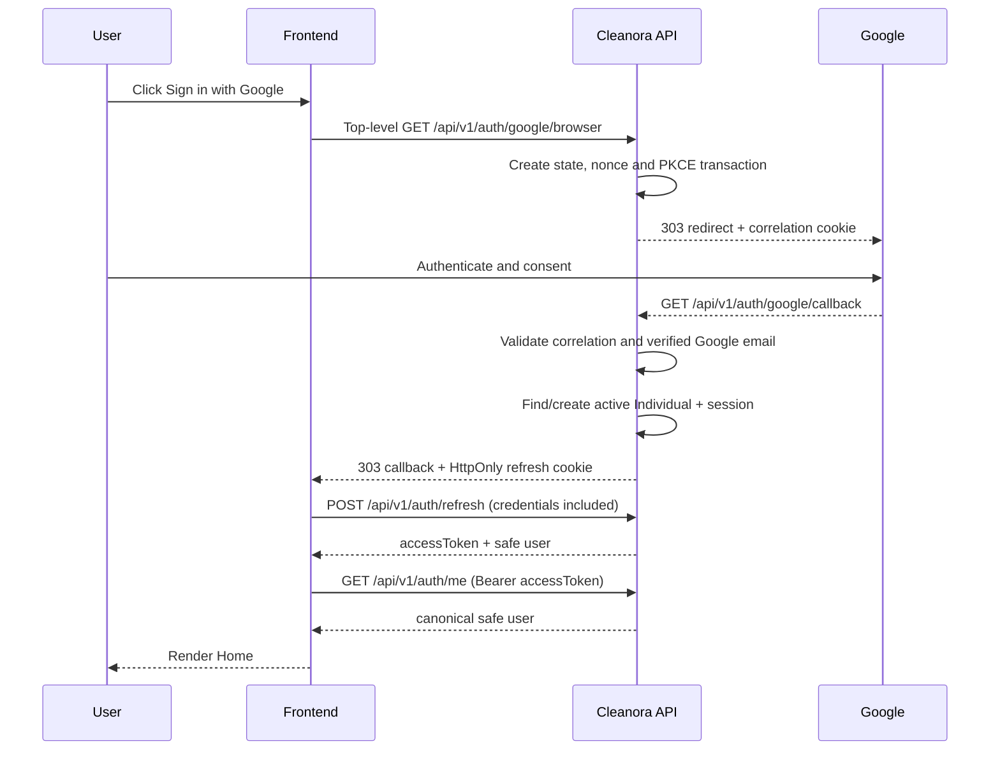

# Google Sign-In — Frontend Integration

Status: R1-P02 email-only identity contract under DEC-028.

## Required environment

The backend owns the Google callback. The frontend owns only the final
allowlisted callback page.

```text
GOOGLE_REDIRECT_URI=https://<api-host>/api/v1/auth/google/callback
GOOGLE_FRONTEND_CALLBACK_URI=https://<frontend-host>/auth/google/callback
```

The frontend origin must also appear in `CORS_ORIGINS`. Production cookies
require HTTPS and `AUTH_COOKIE_SECURE=true`.

## Browser flow



## Start sign-in

Use top-level navigation. Do not fetch this route with XHR and do not start the
flow in Postman before continuing in Chrome.

```ts
window.location.assign(
  `${apiOrigin}/api/v1/auth/google/browser`,
);
```

## Frontend callback

The callback URL contains safe markers only:

```text
/auth/google/callback?google=success&intent=sign-in&verification=complete
```

On that page, bootstrap the session from the HttpOnly refresh cookie:

```ts
const response = await fetch(`${apiBaseUrl}/auth/refresh`, {
  method: "POST",
  credentials: "include",
  headers: { Origin: window.location.origin },
});

const envelope = await response.json();
if (!response.ok) {
  // Show a safe retry message and return to the login page.
}

const { accessToken, user } = envelope.data;
// Keep accessToken in memory only.
```

The frontend must not read, store, or display the refresh cookie. It is
`HttpOnly`. It must not store the access token in `localStorage`.

## Google identity result

Google sign-in is Individual-only. A new identity is accepted only when Google
asserts a verified email. It is immediately eligible for a full session:

```json
{
  "success": true,
  "data": {
    "accessToken": "<short-lived-access-token>",
    "accessExpiresAt": "2026-07-28T12:15:00.000Z",
    "verificationOnly": false,
    "user": {
      "id": "<user-id>",
      "displayName": "Google Display Name",
      "avatarUrl": "https://lh3.googleusercontent.com/...",
      "email": "user@example.com",
      "phone": null,
      "emailVerified": true,
      "phoneVerified": false,
      "status": "ACTIVE",
      "accountCategories": ["INDIVIDUAL"],
      "verifiedCategories": ["INDIVIDUAL"],
      "pendingCategories": []
    }
  },
  "requestId": "<request-id>"
}
```

`phoneVerified: false` is intentional. R1-P02 has no Google phone modal,
`/google/phone/request`, or `/google/phone/verify`. Real phone ownership
verification is deferred to R1-P26.

## Refresh and retry rule

For protected requests:

1. Send `Authorization: Bearer <accessToken>`.
2. On the first access `401`, call `POST /auth/refresh` once with
   `credentials: "include"`.
3. Replace the in-memory access token.
4. Retry the original request once.
5. Never create a recursive refresh loop.

## Security rules

- Never put access tokens, refresh tokens, Google codes, state, nonce, or PKCE
  values in frontend URLs.
- Never merge accounts only because emails match.
- Never accept display name or avatar from the Cleanora client as Google proof.
- Never claim a phone is verified in R1-P02.
- Use Chrome for the redirect flow; use Postman only for contract inspection.
