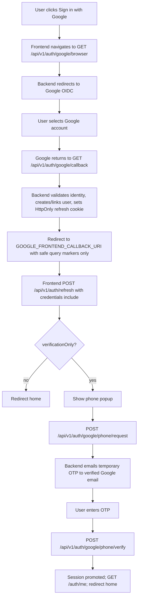

# Google Sign-In Frontend Integration

Status: Implemented in R1-P02; phase remains In Progress.

## Required configuration

- Google Cloud authorized redirect URI:
  `http://localhost:8000/api/v1/auth/google/callback`
- Backend `GOOGLE_REDIRECT_URI`: the same backend URI.
- Backend `GOOGLE_FRONTEND_CALLBACK_URI`:
  `http://localhost:5173/auth/google/callback` for the current local frontend.
- The frontend callback origin must exist in `CORS_ORIGINS`.

Do not register the frontend callback URI with Google. Google returns to the
backend first so Cleanora can validate and consume the OIDC transaction.

The backend does not render a Google success page. Bassam must implement the
frontend callback route and perform the refresh bootstrap described below.

Until a real SMS provider is connected, Google phone OTPs are emailed to the
authenticated user's verified Google email (server-resolved from the linked
SocialAccount). The API challenge remains an SMS phone challenge. Standard
Individual signup uses its normalized account email for the same development
delivery bridge; there is no fixed recipient configuration.

## Sign-in flow



## 1. Initiate Google Sign-In

Use top-level browser navigation (not XHR) so the Google state cookie is owned
by the browser that will complete the callback:

```ts
window.location.assign(
  "http://localhost:8000/api/v1/auth/google/browser",
);
```

Use `/auth/google/browser` for Chrome. Do not call `/auth/google` in Postman and
then copy its authorization URL into Chrome: the state cookie stays in
Postman's cookie jar, so the Chrome callback correctly fails correlation.

## 2. Backend OAuth callback behavior

`GET /api/v1/auth/google/callback`:

- validates correlation cookie, state, nonce, PKCE, and the one-time transaction;
- creates or updates the local Individual user and linked Google SocialAccount;
- establishes the session through the HttpOnly refresh cookie (no tokens in the URL);
- redirects to the configured frontend callback.

## 3. Frontend callback URL

Configured by `GOOGLE_FRONTEND_CALLBACK_URI`, for example:

`http://localhost:5173/auth/google/callback`

Safe query markers only:

- `google=success|error`
- `intent=sign-in|link`
- `verification=phone-required|complete` on successful sign-in
- `reason=correlation-failed|provider-rejected|authentication-failed` on failure

Access tokens, refresh tokens, authorization codes, state values, and raw
provider errors are never placed in the redirect URL.

## 4. Bootstrap the authenticated session

```ts
const response = await fetch(
  "http://localhost:8000/api/v1/auth/refresh",
  {
    method: "POST",
    credentials: "include",
  },
);
const body = await response.json();
// body.data.accessToken, body.data.verificationOnly, body.data.user
```

Required:

- `credentials: "include"` so the HttpOnly refresh cookie is sent
- trusted `Origin` for browser credentialed POSTs (must be in `CORS_ORIGINS`)
- keep the returned access token in memory only; send `Authorization: Bearer <accessToken>`

## 5. Detect phone verification required

Phone verification is required when any of these are true after refresh:

- redirect query `verification=phone-required`
- `data.verificationOnly === true`
- `data.user.phoneVerified === false`
- `GET /auth/me` returns `data.user` with Individual pending / phone not verified

## 6. Phone request and verify schemas

### `POST /api/v1/auth/google/phone/request`

Headers:

- `Authorization: Bearer <verification-only-access-token>`
- `Content-Type: application/json`

Body (strict; extra fields such as `email` are rejected):

```json
{ "phone": "+201234567890" }
```

Success `202`:

```json
{
  "success": true,
  "data": {
    "accepted": true,
    "challengeId": "<uuid>",
    "nextAction": "VERIFY_ACCOUNT",
    "accountCategory": "INDIVIDUAL",
    "purpose": "CATEGORY_VERIFICATION",
    "channel": "SMS",
    "maskedDestination": "+20******7890",
    "expiresAt": "<ISO-8601>",
    "resendAvailableAt": "<ISO-8601>"
  },
  "requestId": "<id>"
}
```

Notes:

- `channel` remains `SMS` because the challenge verifies the phone number.
- During development, the OTP is emailed to the linked verified Google email.
- The OTP is never returned in the response.
- The recipient email is never taken from the request body.

### `POST /api/v1/auth/google/phone/verify`

Headers:

- `Authorization: Bearer <the-same-access-token>`
- `Content-Type: application/json`

Body:

```json
{
  "challengeId": "<challenge-id>",
  "code": "123456"
}
```

Success `200`:

```json
{
  "success": true,
  "data": {
    "verified": true,
    "verificationOnly": false,
    "nextAction": "CONTINUE"
  },
  "requestId": "<id>"
}
```

## 7. Cookies, credentials, headers, CSRF

| Concern | Behavior |
|---|---|
| Refresh cookie | HttpOnly, path `/api/v1/auth`, name from `AUTH_REFRESH_COOKIE_NAME` |
| Google state cookie | Set during `/google/browser`; required for callback correlation |
| Credentialed browser calls | `credentials: "include"` + allowlisted Origin |
| Access token | Bearer header only; never in cookies or URLs |
| CSRF | Trusted-origin check on credentialed auth mutations; refresh cookie is not readable by JS |

## 8. Expected errors

| Situation | Typical result |
|---|---|
| Missing/invalid access token | `401 AUTHENTICATION_REQUIRED` / `AUTH_ACCESS_TOKEN_INVALID` |
| Extra body fields on phone request | `400 REQUEST_VALIDATION_FAILED` |
| Invalid phone format | `400 AUTH_PHONE_FORMAT_INVALID` |
| Phone already owned by another user | `409 AUTH_PHONE_ALREADY_REGISTERED` |
| No verified Google email for delivery | `403 AUTH_GOOGLE_EMAIL_UNAVAILABLE` |
| Invalid / expired / reused / foreign OTP | `400 AUTH_VERIFICATION_FAILED` |
| Email delivery unavailable | `503 AUTH_PROVIDER_UNAVAILABLE` |

## 9. After successful verification

1. Treat the same access token as fully usable after server-side promotion.
2. Call `GET /api/v1/auth/me` with the Bearer token and use `data.user` as the
   canonical updated user.
3. Redirect the user to the home page.
4. Do not restart Google OAuth.

## Linking flow

1. A fully verified individual calls `GET /auth/google/link` with the access
   token.
2. The frontend navigates to the returned `authorizationUrl` in the same
   browser.
3. Google returns to the common backend `/auth/google/callback`.
4. The backend reads the stored `LINK` intent and bound user/session, links the
   provider identity, and redirects to the frontend callback with
   `google=success&intent=link`.

The callback never requires a bearer token from Google or from a callback URL.
