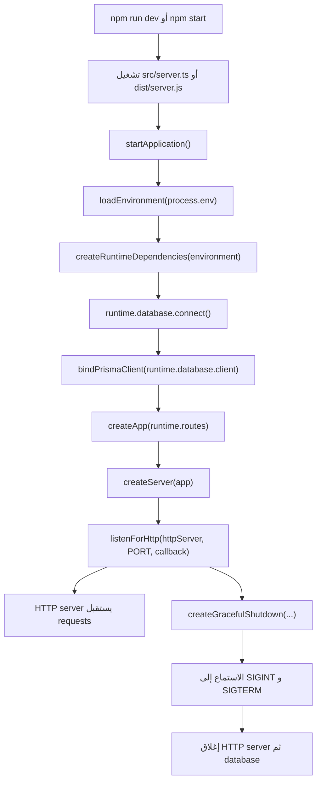
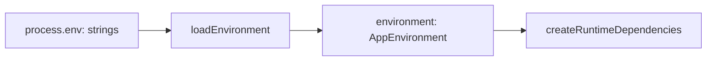
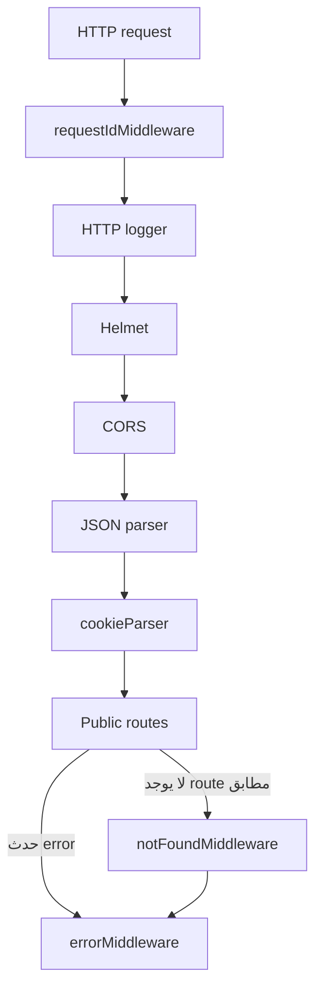
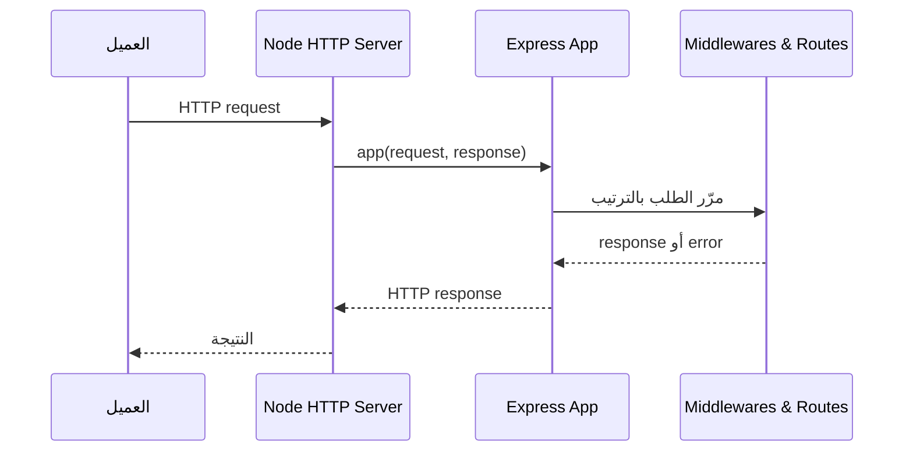
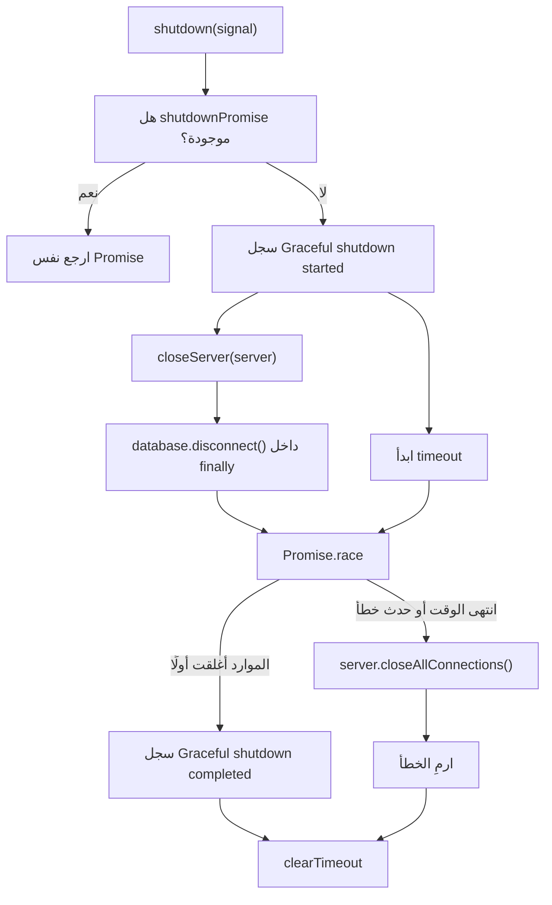
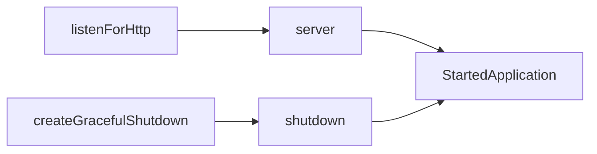
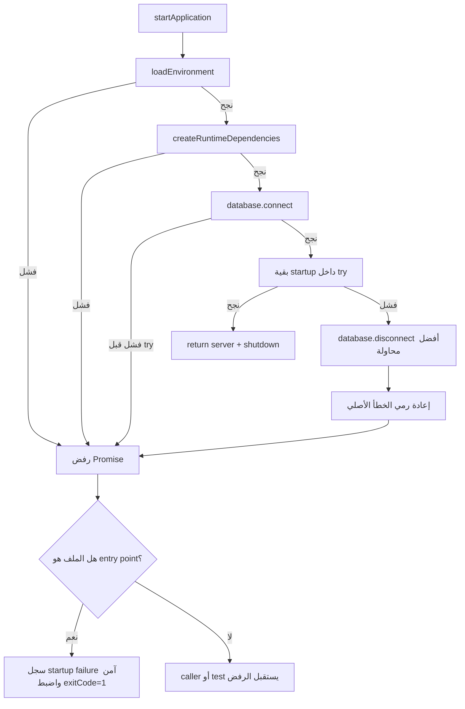
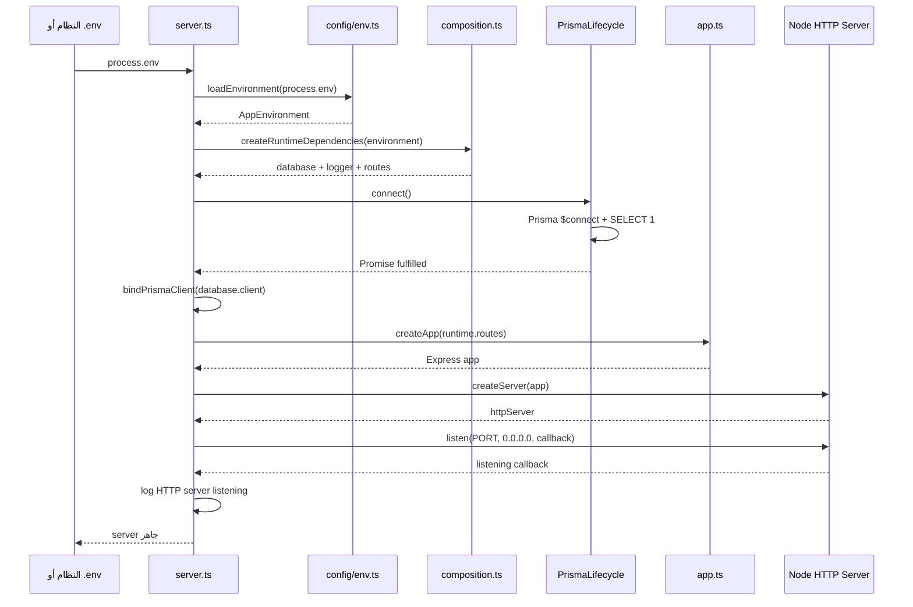
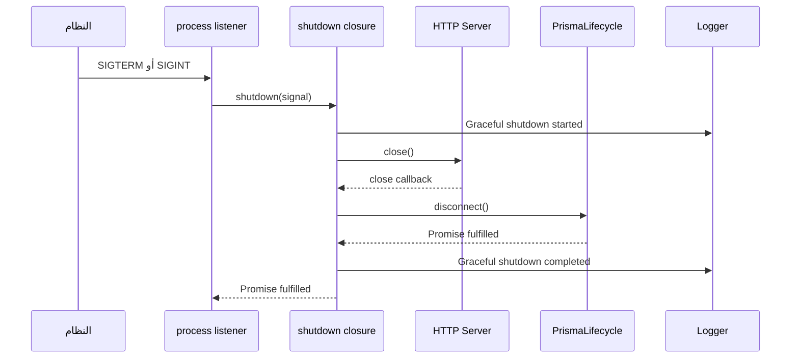

<div dir="rtl" align="right">

# شرح نقطة دخول Cleanora: ملف `src/server.ts`

> **هدف الملف:** فهم رحلة تشغيل التطبيق كاملة، من لحظة تنفيذ أمر التشغيل حتى يصبح السيرفر مستعدًا لاستقبال HTTP requests، ثم فهم ما يحدث عند إيقافه أو فشل تشغيله.

> **حدود الشرح:** هذا المستند يشرح `server.ts` وكل دالة يستدعيها مباشرة، ويصل إلى المستوى اللازم لفهم مصدر كل input والنتيجة والـside effects. التفاصيل الداخلية الكاملة للـauthentication endpoints ستكون في مستندات الملفات التالية، بدايةً من `composition.ts` ثم `auth.module.ts`.

> **تنبيه بخصوص المقتطف المرسل في المحادثة:** العلامات مثل `*signal*` و`*/**` و`*//` ناتجة عن تنسيق النص عند نسخه، وليست TypeScript موجودة في الملف الحقيقي. هذا الشرح مبني على النسخة الفعلية السليمة داخل `src/server.ts`.

## 1. مكان الملف ودوره

- الملف المشروح: [`src/server.ts`](../../src/server.ts)
- نوعه: **Process entry point**، أي نقطة دخول عملية الـbackend.
- مسؤوليته الأساسية: ترتيب تشغيل التطبيق وإيقافه.
- ليس من مسؤوليته تنفيذ business logic أو login أو authorization.

الفكرة الأساسية للملف هي:

```text
اقرأ الإعدادات
→ كوّن dependencies التطبيق
→ اتصل بقاعدة البيانات
→ اربط Prisma client بالتطبيق
→ أنشئ Express app
→ أنشئ HTTP server
→ ابدأ الاستماع
→ جهّز graceful shutdown
```

## 2. الصورة الكاملة قبل التفاصيل



هناك نوعان مختلفان من الـflow داخل الملف:

1. **Startup flow:** يحدث مرة واحدة عند تشغيل الـprocess.
2. **Shutdown flow:** يحدث لاحقًا عندما تصل إشارة إيقاف مثل `SIGINT` أو `SIGTERM`.

## 3. من الذي يشغّل `server.ts`؟

### في development

أمر `npm run dev` معرّف داخل [`package.json`](../../package.json) كالتالي:

```json
"dev": "node --env-file=.env --conditions=development --import tsx src/server.ts"
```

تفسيره بالترتيب:

- `node`: يبدأ Node.js process.
- `--env-file=.env`: يقرأ القيم الموجودة في `.env` ويضعها داخل `process.env`.
- `--conditions=development`: يجعل aliases الموجودة في `package.json` تختار ملفات TypeScript الموجودة في `src`.
- `--import tsx`: يسمح لـNode بتنفيذ TypeScript مباشرة أثناء التطوير.
- `src/server.ts`: الملف الذي يبدأ منه التنفيذ.

إذًا أول input حقيقي للتطبيق يأتي من نظام التشغيل وملف `.env`، ويتجمع داخل:

```ts
process.env
```

### في production

بعد الـbuild، أمر التشغيل هو:

```json
"start": "node dist/server.js"
```

هنا Node ينفذ نسخة JavaScript المبنية من `server.ts`.

## 4. شرح الـimports

### 4.1 الاستيراد من Node.js

```ts
import { createServer, type Server } from "node:http";
```

#### `createServer`

- دالة runtime من Node.js.
- تستقبل HTTP request listener.
- في هذا الملف تستقبل Express app:

```ts
const httpServer = createServer(app);
```

- بعد بدء الاستماع، Node يستدعي `app(request, response)` عند وصول كل HTTP request.

#### `type Server`

- TypeScript type فقط، وليس قيمة runtime.
- استخدام `type` يعني أن الاستيراد يُحذف عند تحويل TypeScript إلى JavaScript.
- استُخدم لتعريف نوع `server` داخل `StartedApplication`.

### 4.2 الاستيرادات باستخدام aliases

```ts
import { APPLICATION_NAME } from "#config/constants";
import {
  createStartupFailureContext,
  loadEnvironment,
} from "#config/env";
import { bindPrismaClient } from "#database/prisma";
import { createApplicationLogger } from "#shared/logger";
```

الرمز `#config/...` ليس package خارجية. هذه aliases معرّفة في `package.json`.

| الـalias | ملف development الفعلي | ملف production الفعلي |
|---|---|---|
| `#config/constants` | `src/config/constants.ts` | `dist/config/constants.js` |
| `#config/env` | `src/config/env.ts` | `dist/config/env.js` |
| `#database/prisma` | `src/database/prisma.ts` | `dist/database/prisma.js` |
| `#shared/logger` | `src/shared/logger.ts` | `dist/shared/logger.js` |

تفاصيل كل قيمة مستوردة:

| الاسم | مكان التعريف | وظيفته في `server.ts` |
|---|---|---|
| `APPLICATION_NAME` | [`src/config/constants.ts`](../../src/config/constants.ts) | قيمته `cleanora-backend` وتُضاف إلى startup error log. |
| `loadEnvironment` | [`src/config/env.ts`](../../src/config/env.ts) | تتحقق من `process.env` وتحولها إلى `AppEnvironment` typed وآمن. |
| `createStartupFailureContext` | [`src/config/env.ts`](../../src/config/env.ts) | تحول خطأ startup إلى log context آمن لا يحتوي القيم السرية. |
| `bindPrismaClient` | [`src/database/prisma.ts`](../../src/database/prisma.ts) | تسجل Prisma client المكوَّن باعتباره client الوحيد للعملية. |
| `createApplicationLogger` | [`src/shared/logger.ts`](../../src/shared/logger.ts) | تنشئ logger منظّمًا ويخفي البيانات الحساسة. |

### 4.3 الاستيرادات النسبية

```ts
import { createApp } from "./app.js";
import { createRuntimeDependencies } from "./composition.js";
import {
  createGracefulShutdown,
  HTTP_BIND_HOST,
  listenForHttp,
} from "./server-lifecycle.js";
```

| الاسم | مكان التعريف | المسؤولية |
|---|---|---|
| `createApp` | [`src/app.ts`](../../src/app.ts) | إنشاء Express app وتركيب الـmiddlewares والـroutes. |
| `createRuntimeDependencies` | [`src/composition.ts`](../../src/composition.ts) | إنشاء database lifecycle وlogger وadapters وroute dependencies. |
| `createGracefulShutdown` | [`src/server-lifecycle.ts`](../../src/server-lifecycle.ts) | إنشاء دالة إيقاف تغلق السيرفر وقاعدة البيانات بأمان. |
| `HTTP_BIND_HOST` | [`src/server-lifecycle.ts`](../../src/server-lifecycle.ts) | ثابت قيمته `0.0.0.0`. |
| `listenForHttp` | [`src/server-lifecycle.ts`](../../src/server-lifecycle.ts) | يستدعي `server.listen` باستخدام الـport والـhost. |

### لماذا نكتب `.js` رغم أن الملف الأصلي `.ts`؟

المشروع يستخدم `moduleResolution: NodeNext`. الكود النهائي الذي يشغله Node هو JavaScript داخل `dist`، لذلك الاستيراد النسبي يُكتب بامتداد `.js`. أثناء development، `tsx` وTypeScript يستطيعان ربط `./app.js` بالمصدر `./app.ts`.

## 5. واجهة `StartedApplication`

```ts
export interface StartedApplication {
  readonly server: Server;
  readonly shutdown: (signal: NodeJS.Signals) => Promise<void>;
}
```

هذه interface تصف القيمة التي ترجعها `startApplication()` بعد نجاح التشغيل.

### `server`

- النوع: `Server` من `node:http`.
- هو HTTP server الحقيقي الذي بدأ الاستماع.
- يمكن للاختبار أو للكود المستدعي الاحتفاظ به وفحصه.

### `shutdown`

- function تستقبل `signal`.
- نوع `signal` هو `NodeJS.Signals` مثل `SIGINT` و`SIGTERM`.
- ترجع `Promise<void>` لأن الإغلاق asynchronous.
- نفس function تُربط بإشارات النظام وتُرجع أيضًا للمستدعي، مما يسمح بإيقاف التطبيق برمجيًا في الاختبارات أو الأدوات.

### معنى `readonly`

يمنع كود TypeScript من استبدال الخاصية بعد إنشاء object:

```ts
const started = await startApplication();

// TypeScript يرفض استبدال started.server أو started.shutdown.
```

لكن `readonly` لا يجعل HTTP server نفسه immutable؛ ما زال يمكن استدعاء methods عليه.

## 6. الدالة الرئيسية `startApplication()`

```ts
export async function startApplication(): Promise<StartedApplication>
```

### الـinputs الصريحة

لا توجد parameters بين القوسين، لذلك الدالة لا تستقبل input صريحًا من caller.

### الـinputs الضمنية

رغم عدم وجود parameters، الدالة تعتمد على inputs خارجية:

| الـinput الضمني | المصدر | أين يُستخدم؟ |
|---|---|---|
| `process.env` | نظام التشغيل و`.env` في development | يُرسل إلى `loadEnvironment`. |
| `SIGINT` | غالبًا `Ctrl+C` في terminal | يشغّل graceful shutdown. |
| `SIGTERM` | deployment platform أو process manager | يشغّل graceful shutdown. |
| إمكانية الاتصال بـPostgreSQL | الشبكة و`DATABASE_URL` | داخل `runtime.database.connect()`. |
| إمكانية حجز الـport | نظام التشغيل | داخل `server.listen(...)`. |
| الوقت الحالي | النظام | يستخدمه logger عند كتابة log. |

### الـoutput

عند النجاح ترجع Promise تنتهي بالقيمة:

```ts
{
  server,
  shutdown,
}
```

عند الفشل ترفض الـPromise بالخطأ الأصلي.

### الـside effects

الدالة لا تحسب قيمة فقط؛ بل تغيّر حالة العملية والبيئة المحيطة:

- تنشئ PostgreSQL pool وPrisma client.
- تفتح اتصالًا بقاعدة البيانات.
- تسجل Prisma client على مستوى العملية.
- تنشئ Express app.
- تحجز network port.
- تضيف listeners إلى `process` لإشارات الإيقاف.
- تكتب logs.
- قد تضبط `process.exitCode` عند الفشل.

## 7. الخطوة الأولى: قراءة وتحقيق الـenvironment

الكود:

```ts
const environment = loadEnvironment(process.env);
```

### مكان `loadEnvironment`

موجودة في [`src/config/env.ts`](../../src/config/env.ts):

```ts
export function loadEnvironment(
  input: NodeJS.ProcessEnv = process.env
): AppEnvironment {
  return environmentSchema.parse(input);
}
```

### الـinput الفعلي في هذا الاستدعاء

القيمة المرسلة ليست default؛ `server.ts` يرسل صراحةً:

```ts
process.env
```

وهي object قيمه في الأصل strings أو `undefined`.

مثال قبل التحويل:

```ts
{
  PORT: "8000",
  AUTH_ENABLED: "true",
  DATABASE_URL: "postgresql://..."
}
```

بعد Zod parsing تصبح الأنواع المناسبة:

```ts
{
  PORT: 8000,
  AUTH_ENABLED: true,
  DATABASE_URL: "postgresql://..."
}
```

### ماذا تفعل `environmentSchema.parse`؟

- تتحقق من وجود القيم المطلوبة.
- تحول الأرقام المكتوبة كنص إلى numbers.
- تحول flags مثل `"true"` إلى booleans.
- تطبق defaults عند غياب القيم الاختيارية.
- تقسّم `CORS_ORIGINS` من string مفصولة بفواصل إلى array.
- تتحقق من شكل PostgreSQL URL.
- تتحقق من قوة واستقلال أسرار authentication.
- تتحقق من تناسق إعدادات cookie وGoogle وSMTP.
- ترمي `ZodError` فورًا إذا كانت الإعدادات غير صالحة.

### أهم القيم التي يستخدمها startup مباشرة أو بصورة غير مباشرة

| القيمة بعد التحويل | مصدرها الأصلي | المستهلك |
|---|---|---|
| `PORT` | `process.env.PORT` أو default `8000` | `listenForHttp`. |
| `DATABASE_URL` | `process.env.DATABASE_URL` | `PrismaLifecycle`. |
| `LOG_LEVEL` | `process.env.LOG_LEVEL` أو `info` | application logger. |
| `NODE_ENV` | `process.env.NODE_ENV` أو `development` | logger وHTTP middleware. |
| `API_PREFIX` | `process.env.API_PREFIX` أو `/api/v1` | route mounting. |
| `CORS_ORIGINS` | `process.env.CORS_ORIGINS` | CORS وtrusted-origin auth guard. |
| `REQUEST_BODY_LIMIT` | env أو `1mb` | Express JSON parser. |
| `SHUTDOWN_TIMEOUT_MS` | env أو `10000` | graceful shutdown timeout. |
| `AUTH_ENABLED` | env أو `false` | إنشاء أو عدم إنشاء auth router. |
| JWT/cookie/SMTP/Google values | مجموعات env مرتبطة | authentication adapters عند التفعيل. |

### لماذا هذه الخطوة أولًا؟

إذا كانت الإعدادات ناقصة أو غير آمنة، يجب أن يفشل التطبيق قبل:

- إنشاء runtime كامل.
- محاولة الاتصال بقاعدة البيانات.
- فتح network port.
- قبول أي request.

وهذا السلوك مغطى باختبار في [`tests/unit/config/env.test.ts`](../../tests/unit/config/env.test.ts).

## 8. الخطوة الثانية: تكوين runtime dependencies

الكود:

```ts
const runtime = createRuntimeDependencies(environment);
```

### مكان الدالة

[`src/composition.ts`](../../src/composition.ts)

### الـinput الفعلي

`environment` هو **نفس object** الذي رجع من `loadEnvironment` في الخطوة السابقة، ونوعه `AppEnvironment`.



### ماذا ترجع؟

ترجع object مطابقًا للواجهة:

```ts
export interface RuntimeDependencies {
  readonly database: PrismaLifecycle;
  readonly logger: Logger;
  readonly routes: RouteDependencies;
}
```

أي أن `runtime` يحتوي:

- `runtime.database`: مالك Prisma client والـPostgreSQL pool.
- `runtime.logger`: logger التطبيق.
- `runtime.routes`: كل dependencies المطلوبة لبناء Express والـroutes.

### كيف يتكوّن `runtime.logger`؟

داخل `composition.ts`:

```ts
const logger = createApplicationLogger(environment.LOG_LEVEL, {
  application: APPLICATION_NAME,
  environment: environment.NODE_ENV,
});
```

مصدر كل input:

| input | مصدره |
|---|---|
| `environment.LOG_LEVEL` | `process.env.LOG_LEVEL` بعد validation/default. |
| `APPLICATION_NAME` | ثابت من `src/config/constants.ts` وقيمته `cleanora-backend`. |
| `environment.NODE_ENV` | `process.env.NODE_ENV` بعد validation/default. |

الـlogger يكتب JSON lines ويستخدم `sanitizeLogContext` لإخفاء المفاتيح الحساسة مثل password وtoken وsecret وemail وphone وcookie.

### كيف يتكوّن `runtime.database`؟

```ts
const database = new PrismaLifecycle(environment.DATABASE_URL);
```

مصدر الـinput:

```text
process.env.DATABASE_URL
→ loadEnvironment
→ environment.DATABASE_URL
→ new PrismaLifecycle(...)
```

Constructor الخاص بـ`PrismaLifecycle`:

- ينشئ `pg.Pool`.
- الحد الافتراضي للاتصالات هو `2`.
- ينشئ `PrismaPg` adapter باستخدام الـpool.
- ينشئ Prisma client واحدًا باستخدام الـadapter.
- **لا يتصل بقاعدة البيانات بعد**؛ الاتصال الفعلي يحدث في الخطوة التالية.

وهذه النقطة مثبتة باختبار `runtime composition`: استدعاء `createRuntimeDependencies` لا يستدعي `database.connect()`.

### كيف يتكوّن rate limiter؟

```ts
const rateLimiter = new MemoryRateLimiterAdapter();
```

- لا يأخذ input من `server.ts`.
- يُنشأ مرة واحدة ويُشارك بين system routes وauthentication routes.

### كيف يتكوّن authentication router؟

```ts
const authenticationRouter = createAuthenticationRouter(
  environment,
  rateLimiter,
);
```

هذه `createAuthenticationRouter` دالة private داخل `composition.ts`، وليست الدالة الموجودة في `auth.routes.ts` رغم تشابه الاسم.

#### إذا كان `AUTH_ENABLED=false`

ترجع:

```ts
undefined
```

وبالتالي لا يُضاف `/auth` إلى public route map.

#### إذا كان `AUTH_ENABLED=true`

تُنشئ وتربط:

- email provider.
- Argon2 password hasher.
- JWT token service.
- crypto verifier.
- authentication policy.
- authentication email adapter.
- rate limiter المشترك.
- Google adapters إذا كان `GOOGLE_AUTH_ENABLED=true`.
- authentication module، ثم تأخذ منه `authentication.router`.

مصادر أهم inputs:

| dependency | inputs الأصلية |
|---|---|
| JWT adapter | access secret، refresh secret، issuer، audience، access TTL من environment. |
| Cookie configuration | name، path، secure، sameSite من environment. |
| Crypto verifier | `AUTH_VERIFIER_SECRET`. |
| Privacy hashing | `AUTH_PRIVACY_HASH_SECRET`. |
| Email adapter | SMTP group بعد validation. |
| Google adapter | client ID، client secret، provider callback URI. |
| Google frontend handoff | frontend callback URI. |
| Trusted origins | `CORS_ORIGINS`. |

علامة `!` الموجودة بعد بعض قيم environment داخل `composition.ts` هي TypeScript non-null assertion. سبب الأمان هنا أن `loadEnvironment` يمنع `AUTH_ENABLED=true` إذا كانت القيم المطلوبة ناقصة.

### شكل `runtime.routes`

القيمة المرجعة تكون منطقيًا:

```ts
{
  environment,
  logger,
  rateLimiter,
  databaseProbe: database.databaseProbe(),
  readinessProbes: [database.readinessProbe()],
  // موجودة فقط عندما يكون auth مفعّلًا:
  authenticationRouter,
}
```

لاحظ أن `environment` و`logger` و`rateLimiter` هنا هي نفس instances التي تم إنشاؤها، وليست نسخًا جديدة.

## 9. الخطوة الثالثة: الاتصال بقاعدة البيانات

الكود:

```ts
await runtime.database.connect();
```

### مكان `connect`

method داخل class `PrismaLifecycle` في [`src/database/prisma-lifecycle.ts`](../../src/database/prisma-lifecycle.ts).

### الـinput الفعلي

لا يوجد parameter وقت الاستدعاء، لكن الـinstance تحمل مسبقًا:

- Prisma client.
- PostgreSQL pool.
- `DATABASE_URL` الذي دخل إلى constructor أثناء composition.

إذن أصل input الاتصال هو:

```text
process.env.DATABASE_URL
→ loadEnvironment
→ createRuntimeDependencies
→ new PrismaLifecycle(DATABASE_URL)
→ runtime.database.connect()
```

### الكود الداخلي المهم

```ts
async connect(): Promise<void> {
  this.connectPromise ??= (async () => {
    await this.client.$connect();
    await this.client.$queryRaw`SELECT 1`;
  })();
  await this.connectPromise;
}
```

ما يحدث:

1. أول استدعاء ينشئ Promise ويخزنها في `connectPromise`.
2. Prisma ينفذ `$connect()`.
3. ينفذ `SELECT 1` لتسخين اتصال من الـpool والتأكد من جاهزيته.
4. الاستدعاءات المتزامنة التالية تنتظر نفس Promise بدل فتح اتصالات startup متعددة.

### لماذا يوجد `await`؟

حتى لا ينتقل التطبيق إلى فتح HTTP port قبل نجاح اتصال قاعدة البيانات. لذلك التطبيق لا يقبل requests وهو غير قادر على استخدام قاعدة البيانات.

### نقطة دقيقة عن مكان `try`

هذا الاستدعاء موجود **قبل** `try` الداخلي:

```ts
await runtime.database.connect();

try {
  // بقية startup
}
```

النتيجة:

- إذا فشل `connect()`، ترفض `startApplication()` مباشرة.
- فرع `runtime.database.disconnect()` الموجود في `catch` الداخلي لا يُنفذ؛ لأنه لم يتم دخول `try` بعد.
- عند التشغيل المباشر، `.catch(...)` الموجود في نهاية `server.ts` يستقبل الخطأ ويسجله.

## 10. الخطوة الرابعة: ربط Prisma client على مستوى العملية

الكود:

```ts
bindPrismaClient(runtime.database.client);
```

### الـinput الفعلي

```text
runtime.database
→ الخاصية client التي أنشأها PrismaLifecycle constructor
→ bindPrismaClient(client)
```

النوع المطلوب هو `PrismaClient`.

### ماذا تفعل `bindPrismaClient`؟

داخل [`src/database/prisma.ts`](../../src/database/prisma.ts) يوجد variable على مستوى module:

```ts
let prismaClient: PrismaClient | undefined;
```

ثم الربط:

```ts
export function bindPrismaClient(client: PrismaClient): void {
  if (prismaClient === undefined) {
    prismaClient = client;
    return;
  }

  if (prismaClient !== client) {
    throw new Error("A different process-wide Prisma client is already bound");
  }
}
```

القواعد:

- أول client يتم حفظه.
- إعادة ربط **نفس object identity** مسموح ولا تفعل شيئًا.
- محاولة استبداله بـclient مختلف ترمي خطأ.

### لماذا هذا الربط مهم؟

Repositories تحصل على client من `getPrismaClient()`. الربط يضمن أن:

- repositories.
- health probes.
- startup.
- graceful shutdown.

كلها تشير إلى نفس Prisma client ونفس connection pool، فلا يتكوّن أكثر من client دون قصد.

### لماذا يأتي الربط بعد الاتصال؟

الترتيب الحالي يضمن عدم إتاحة client للعملية إلا بعد نجاح الاتصال والـwarm-up query.

## 11. الخطوة الخامسة: إنشاء Express app

الكود:

```ts
const app = createApp(runtime.routes);
```

### الـinput الفعلي

هو `runtime.routes` الناتج من `createRuntimeDependencies`، ويحتوي environment وlogger وrate limiter والـprobes والـauthentication router الاختياري.

الدالة لها parameter ثانٍ اختياري للاختبارات:

```ts
createApp(routes, options = {})
```

لكن `server.ts` لا يرسله، لذلك قيمته هنا هي object فارغ `{}`.

### ما الذي تفعله `createApp`؟

داخل [`src/app.ts`](../../src/app.ts):

1. تنشئ Express app.
2. تخفي header الخاص بـExpress: `x-powered-by`.
3. تركب request ID middleware.
4. تركب HTTP logger.
5. تركب Helmet security headers.
6. تركب CORS باستخدام `environment.CORS_ORIGINS`.
7. تركب JSON parser باستخدام `environment.REQUEST_BODY_LIMIT`.
8. تركب cookie parser.
9. تستدعي `mountRoutes(app, routes)`.
10. لا تركب test routes لأن `options` فارغة في production startup.
11. تركب 404 middleware.
12. تركب error middleware باستخدام `routes.logger`.
13. ترجع Express app.

ترتيب الـmiddleware مهم جدًا؛ كل request يمر بهذا الترتيب:



### ما الـroutes التي تُركّب؟

`mountRoutes` موجودة في [`src/routes/index.ts`](../../src/routes/index.ts):

- `${API_PREFIX}/docs`
- `${API_PREFIX}/system`
- `${API_PREFIX}/auth` فقط إذا كان `authenticationRouter` موجودًا.

إذا كانت القيمة الافتراضية `API_PREFIX=/api/v1`، تصبح المسارات الأساسية:

```text
/api/v1/docs
/api/v1/system
/api/v1/auth   ← عند تفعيل authentication فقط
```

## 12. الخطوة السادسة: تحويل Express إلى Node HTTP server

الكود:

```ts
const httpServer = createServer(app);
```

### الـinput الفعلي

`app` هو نفس Express application الذي رجع من `createApp(runtime.routes)` في السطر السابق.

### لماذا يقبل `createServer` Express app؟

Express app عبارة عن callable request listener متوافق مع Node HTTP. مفهومه المبسط:

```ts
(request, response) => void
```

Node يحفظ هذا listener. بعد بدء الاستماع، كلما يصل request يستدعيه Node ويبدأ Express في تمرير الطلب عبر الـmiddleware stack.



### النتيجة

`httpServer` موجود الآن، لكنه لم يبدأ الاستماع بعد. إنشاء server وحجز port خطوتان منفصلتان.

## 13. الخطوة السابعة: بدء الاستماع

الكود:

```ts
const server = listenForHttp(httpServer, environment.PORT, () => {
  runtime.logger.info("HTTP server listening", {
    host: HTTP_BIND_HOST,
    port: environment.PORT,
  });
});
```

### مكان `listenForHttp`

[`src/server-lifecycle.ts`](../../src/server-lifecycle.ts)

```ts
export function listenForHttp(
  server: HttpServer,
  port: number,
  onListening: () => void,
): Server {
  return server.listen(port, HTTP_BIND_HOST, onListening);
}
```

### الـinputs واحدًا واحدًا

#### 1. `httpServer`

مصدره:

```text
createApp(runtime.routes)
→ app
→ createServer(app)
→ httpServer
```

#### 2. `environment.PORT`

مصدره:

```text
process.env.PORT كنص
→ loadEnvironment يحوله إلى number
→ environment.PORT
```

إذا لم تُرسل القيمة، default هو `8000`.

#### 3. الـcallback

هذه function لا ينفذها `server.ts` فور تعريفها. تُرسل إلى `listenForHttp`، ثم إلى:

```ts
server.listen(port, host, callback)
```

Node هو الذي يستدعيها بعد نجاح بدء الاستماع.

عند استدعائها تكتب log بالمعلومات:

```ts
{
  host: "0.0.0.0",
  port: environment.PORT,
}
```

#### 4. `HTTP_BIND_HOST`

ثابت قيمته:

```ts
"0.0.0.0"
```

هذا يعني الاستماع على كل network interfaces المتاحة داخل الجهاز أو الـcontainer، وليس localhost فقط.

### القيمة المرجعة

`listenForHttp` ترجع نتيجة `server.listen(...)`، وهي Node `Server`. لذلك:

```ts
server === httpServer
```

من حيث object identity؛ الاسم تغير ليعبّر أن الـserver بدأ الاستماع.

## 14. الخطوة الثامنة: إنشاء graceful shutdown

الكود:

```ts
const shutdown = createGracefulShutdown(
  server,
  runtime.database,
  runtime.logger,
  environment.SHUTDOWN_TIMEOUT_MS,
);
```

### الـinputs ومصادرها

| input | القيمة الفعلية | المصدر |
|---|---|---|
| `server` | HTTP Server الذي بدأ الاستماع | نتيجة `listenForHttp`. |
| `runtime.database` | `PrismaLifecycle` instance | `createRuntimeDependencies`. |
| `runtime.logger` | application logger | `createRuntimeDependencies`. |
| `environment.SHUTDOWN_TIMEOUT_MS` | number موجب، default `10000` | `process.env` بعد Zod parsing. |

### ما الذي ترجع `createGracefulShutdown`؟

لا تغلق شيئًا وقت الاستدعاء. هي **factory function** ترجع function جديدة:

```ts
(signal: NodeJS.Signals) => Promise<void>
```

هذه function الجديدة تحتفظ بالـserver والـdatabase والـlogger والـtimeout داخل closure، ولذلك لا نحتاج لإرسالهم مرة أخرى عند كل shutdown.

### المسار الداخلي للـshutdown



### لماذا shutdown idempotent؟

داخل الدالة:

```ts
let shutdownPromise: Promise<void> | undefined;
```

ثم:

```ts
shutdownPromise ??= /* عملية الإغلاق */;
```

إذا وصلت `SIGINT` و`SIGTERM` قريبًا من بعضهما، كلا الاستدعاءين يرجعان نفس Promise. وبذلك:

- `server.close()` يحدث مرة واحدة.
- `database.disconnect()` يحدث مرة واحدة.
- لا توجد عمليتا shutdown متنافستان.

### ترتيب إغلاق الموارد

1. `server.close(...)` يوقف قبول اتصالات جديدة وينتظر إغلاق server بصورة طبيعية.
2. في `finally` يتم `database.disconnect()` حتى لو فشل إغلاق السيرفر.
3. إذا تجاوزت العملية timeout، يحدث `server.closeAllConnections()`.
4. يتم تنظيف timer في `finally`.

## 15. دالة `logShutdownError`

الكود:

```ts
const logShutdownError = (error: unknown): void => {
  runtime.logger.error("Graceful shutdown failed", {
    errorName: error instanceof Error ? error.name : "UnknownError",
  });
  process.exitCode = 1;
};
```

### من يستدعيها؟

لا تُستدعى مباشرة. تُرسل كـrejection handler إلى:

```ts
shutdown("SIGINT").catch(logShutdownError)
shutdown("SIGTERM").catch(logShutdownError)
```

الـPromise نفسها هي التي تستدعيها إذا رفضت عملية shutdown.

### الـinput الفعلي

`error` هو نفس سبب رفض Promise الراجعة من `shutdown`، مثل:

- خطأ من `server.close`.
- خطأ من `database.disconnect`.
- `Error("Graceful shutdown timed out")`.

### لماذا النوع `unknown`؟

JavaScript يسمح برمي أي قيمة، وليس `Error` فقط. لذلك يجب فحصها:

```ts
error instanceof Error
```

إذا كانت Error يسجل الاسم فقط، مثل `Error`. وإذا لم تكن Error يسجل `UnknownError`.

### لماذا لا يسجل `error.message`؟

الرسالة قد تحتوي تفاصيل اتصال أو بيانات حساسة. الكود يختار اسم الخطأ فقط في هذا الموضع.

### لماذا `process.exitCode = 1` بدل `process.exit(1)`؟

- يعلن أن العملية فشلت.
- لا يقطع التنفيذ فورًا في منتصف عمليات I/O.
- يسمح لـNode بالخروج طبيعيًا عندما تنتهي الأعمال المفتوحة.

## 16. ربط shutdown بإشارات النظام

```ts
process.once("SIGINT", () => {
  void shutdown("SIGINT").catch(logShutdownError);
});

process.once("SIGTERM", () => {
  void shutdown("SIGTERM").catch(logShutdownError);
});
```

### `SIGINT`

غالبًا تصل عند ضغط `Ctrl+C` أثناء التشغيل المحلي.

### `SIGTERM`

غالبًا يرسلها deployment platform أو process manager عندما يريد إيقاف النسخة.

### لماذا `process.once`؟

لأن كل listener يجب أن يعمل مرة واحدة فقط. هذا بالإضافة إلى idempotency داخل `shutdown` يعطي حمايتين من تكرار الإغلاق.

### من يستدعي الـcallbacks؟

Node process event system هو الذي يستدعي:

```ts
() => {
  void shutdown("SIGINT").catch(logShutdownError);
}
```

أو callback الخاص بـ`SIGTERM` عند وصول الإشارة.

### مصدر input الخاص بـ`shutdown`

القيمة ليست مأخوذة من event parameter؛ الكود يمرر literal ثابتًا مناسبًا لكل listener:

```ts
shutdown("SIGINT")
shutdown("SIGTERM")
```

### معنى `void` قبل `shutdown`

الـcallback الذي أعطيناه إلى `process.once` لا ينتظر Promise. استخدام:

```ts
void shutdown(...).catch(...)
```

يوضح عمدًا أننا لا نرجع الـPromise إلى event emitter، مع الحفاظ على معالجة رفضها بواسطة `.catch(logShutdownError)`.

بدون `.catch(...)` كان يمكن أن يحدث unhandled Promise rejection.

## 17. القيمة المرجعة بعد نجاح startup

```ts
return { server, shutdown };
```

ترجع الدالة نفس الـserver ونفس shutdown closure اللذين تم إنشاؤهما.



caller يمكنه تنفيذ:

```ts
const started = await startApplication();
await started.shutdown("SIGTERM");
```

لكن عند التشغيل العادي، signal listeners هم الذين يستدعون `shutdown`.

## 18. `try/catch` الداخلي وتنظيف فشل startup

الكود:

```ts
try {
  // bind Prisma, create app, listen, configure shutdown
  return { server, shutdown };
} catch (error: unknown) {
  try {
    await runtime.database.disconnect();
  } catch {
    // Keep the original startup error as the useful failure.
  }
  throw error;
}
```

### متى يعمل هذا الـcatch؟

عندما يحدث خطأ داخل `try` بعد نجاح `runtime.database.connect()`، مثل خطأ synchronous أثناء:

- `bindPrismaClient`.
- `createApp`.
- `createServer`.
- `listenForHttp` إذا رمى استدعاؤه خطأ بصورة synchronous.
- إعداد graceful shutdown أو signal listeners.

### لماذا يوجد `catch` داخلي آخر حول disconnect؟

لدينا خطآن محتملان:

1. خطأ startup الأصلي.
2. خطأ أثناء تنظيف database.

الكود يتعمد الحفاظ على الخطأ الأول لأنه يشرح سبب فشل startup. لذلك يتجاهل خطأ التنظيف ثم يعيد رمي:

```ts
throw error;
```

وهي نفس القيمة الأصلية، وليست Error جديدة.

## 19. التشغيل الذاتي: `require.main === module`

```ts
if (require.main === module) {
  void startApplication().catch(/* ... */);
}
```

### معنى الشرط

- `require.main`: module الذي بدأ منه Node process.
- `module`: الـmodule الحالي، أي `server.ts` أو نسخته `server.js`.

إذا كانا نفس الشيء، فهذا الملف هو نقطة الدخول، فيبدأ التطبيق تلقائيًا.

### حالتان مهمتان

| طريقة الاستخدام | نتيجة الشرط | السلوك |
|---|---:|---|
| `node dist/server.js` أو أمر development | `true` | يتم استدعاء `startApplication()` تلقائيًا. |
| `import { startApplication } from ".../server.js"` داخل test | `false` | لا يبدأ server تلقائيًا؛ الاختبار يقرر هل يستدعي الدالة. |

هذا الفصل مهم للاختبارات: مجرد import لا يجب أن يحجز port أو يتصل بقاعدة البيانات.

## 20. معالجة فشل التشغيل النهائي

الكود:

```ts
void startApplication().catch((error: unknown) => {
  const logger = createApplicationLogger("error", {
    application: APPLICATION_NAME,
  });
  logger.error(
    "Application startup failed",
    createStartupFailureContext(error),
  );
  process.exitCode = 1;
});
```

### من يستدعي callback الخاص بـ`.catch`؟

الـPromise الراجعة من `startApplication()` تستدعيه عندما ترفض.

### لماذا ينشئ logger جديدًا؟

فشل التشغيل قد يحدث قبل إنشاء `runtime.logger`، مثل فشل `loadEnvironment`. لذلك لا يمكن الاعتماد على runtime logger هنا.

### inputs الخاصة بـ`createApplicationLogger`

```ts
createApplicationLogger("error", {
  application: APPLICATION_NAME,
})
```

- مستوى log literal هو `"error"`، لذلك سيكتب رسائل الخطأ.
- `application` تأتي من ثابت `APPLICATION_NAME = "cleanora-backend"`.
- لا يعتمد logger الاحتياطي على environment قد تكون invalid أصلًا.

### `createStartupFailureContext(error)`

موجودة في `src/config/env.ts`. تستقبل خطأ startup الأصلي وتنتج object آمنًا.

قد تُرجع مثلًا:

```ts
{
  errorName: "ZodError",
  environmentDiagnostics: [
    {
      field: "DATABASE_URL",
      code: "invalid_type",
      message: "DATABASE_URL is required",
    },
  ],
}
```

أو مع خطأ قاعدة بيانات يحمل code آمنة الشكل:

```ts
{
  errorName: "Error",
  errorCode: "P1001",
}
```

لا يضم raw environment values أو raw Zod input، ولذلك لا يطبع password أو database URL أو JWT secret.

## 21. خريطة مسارات النجاح والفشل



### جدول الفشل الدقيق

| مكان الفشل | هل database اتصلت؟ | هل يحاول الـcatch الداخلي disconnect؟ | من يستقبل الخطأ بعد ذلك؟ |
|---|---:|---:|---|
| `loadEnvironment` | لا | لا | caller أو `.catch` النهائي. |
| `createRuntimeDependencies` | لا | لا | caller أو `.catch` النهائي. |
| `runtime.database.connect` | المحاولة فشلت | لا، لأنه قبل `try` | caller أو `.catch` النهائي. |
| أي خطوة synchronous داخل `try` | نعم | نعم | يُعاد رمي الأصل ثم caller أو `.catch` النهائي. |
| graceful shutdown لاحقًا | كانت متصلة | shutdown نفسها تحاول disconnect | `logShutdownError`. |

## 22. أماكن استدعاء `startApplication()` في المشروع الحالي

بحسب البحث في النسخة الحالية من المشروع، توجد الاستدعاءات المباشرة التالية:

### 1. التشغيل الذاتي داخل `src/server.ts`

```ts
if (require.main === module) {
  void startApplication().catch(...);
}
```

- لا توجد parameters.
- inputs تأتي ضمنيًا من `process.env` ونظام التشغيل.

### 2. اختبار فشل environment

الملف: [`tests/unit/config/env.test.ts`](../../tests/unit/config/env.test.ts)

الاختبار يحذف `process.env.DATABASE_URL` مؤقتًا ثم يستدعي:

```ts
await expect(startApplication()).rejects.toBeDefined();
```

مسار input في الاختبار:

```text
الاختبار يحذف process.env.DATABASE_URL
→ startApplication()
→ loadEnvironment(process.env)
→ Zod يكتشف أن DATABASE_URL غير موجودة
→ startApplication Promise تُرفض
→ expect(...).rejects يتحقق من الفشل
```

الاختبار يعيد القيمة الأصلية داخل `finally` حتى لا يلوّث الاختبارات التالية.

لا يوجد حاليًا استدعاء مباشر آخر لـ`startApplication()` داخل `src` أو `tests`.

## 23. الـcallbacks غير المباشرة: من يستدعي ماذا؟

من المهم عدم اعتبار كل function ظاهرة استدعاءً مباشرًا من `server.ts`.

| الـfunction أو callback | من يحتفظ بها؟ | من يستدعيها فعليًا؟ | متى؟ |
|---|---|---|---|
| `app` | Node HTTP Server | Node HTTP Server | عند كل HTTP request. |
| listening callback | Node `Server` | Node | بعد نجاح بدء الاستماع. |
| callback الخاص بـ`SIGINT` | `process` EventEmitter | Node process | عند وصول `SIGINT`. |
| callback الخاص بـ`SIGTERM` | `process` EventEmitter | Node process | عند وصول `SIGTERM`. |
| `shutdown` | signal callbacks وcaller | callback الخاص بالإشارة أو caller | وقت الإيقاف. |
| `logShutdownError` | Promise `.catch` | Promise machinery | فقط عند رفض shutdown. |
| startup catch callback | Promise `.catch` | Promise machinery | فقط عند رفض `startApplication`. |

## 24. تسلسل startup كاملًا



## 25. تسلسل shutdown كاملًا



إذا تجاوز الإغلاق الـtimeout، تستدعي shutdown:

```ts
server.closeAllConnections();
```

ثم ترفض Promise، فيصل الخطأ إلى `logShutdownError` ويصبح `process.exitCode = 1`.

## 26. الاختبارات التي تثبت سلوك هذا المسار

### `tests/unit/server/startup.test.ts`

اختبار readability بنيوي يقرأ source نفسه ويتأكد أن الخطوات موجودة بهذا الترتيب:

1. `loadEnvironment(process.env)`
2. `createRuntimeDependencies(environment)`
3. `runtime.database.connect()`
4. `createApp(runtime.routes)`
5. `createServer(app)`
6. `listenForHttp(httpServer, ...)`
7. تسجيل `SIGINT`
8. تسجيل `SIGTERM`

هذا الاختبار لا يشغّل السيرفر؛ بل يحمي وضوح وترتيب entry point من الرجوع إلى factory override plumbing معقد.

### `tests/unit/config/env.test.ts`

يثبت أن:

- القيم تُحوّل وتُتحقق بصورة صحيحة.
- الإعدادات غير الآمنة تُرفض.
- غياب `DATABASE_URL` يفشل قبل database composition أو listening.
- startup error context لا يكشف الأسرار.

### `tests/unit/server/composition.test.ts`

يثبت أن `createRuntimeDependencies(environment)`:

- ينشئ `PrismaLifecycle`.
- لا يستدعي `connect()`.
- يمرر نفس environment وlogger إلى routes.
- يضيف readiness probe.
- لا يضيف authentication router عندما يكون auth غير مفعّل.

### `tests/unit/server/http-binding.test.ts`

يثبت أن `listenForHttp`:

- يمرر الـport كما هو.
- يستخدم `0.0.0.0`.
- يمرر callback.
- يرجع نفس server.
- يؤدي إلى استدعاء listening callback في الاختبار.

### `tests/unit/server/app-routing.test.ts`

يثبت ترتيب global middleware والـroutes والـterminal handlers، ويختبر:

- live health route.
- test route قبل 404.
- 404 لمسار غير موجود.

### `tests/unit/server/route-map.test.ts`

يثبت تركيب مجموعات:

- docs.
- system health.
- authentication عند إرسال router.

### `tests/unit/integrations/prisma-lifecycle.test.ts`

يثبت أن:

- connect وdisconnect يحدث كل منهما مرة واحدة حتى مع الاستدعاءات المتوازية.
- Prisma client واحد مشترك بين repositories والـprobes.
- graceful shutdown يغلق server وdatabase مرة واحدة.
- timeout يجبر إغلاق الاتصالات.
- ربط Prisma client مختلف مرفوض.

## 27. مصطلحات TypeScript وJavaScript المهمة في الملف

### `async` و`Promise<StartedApplication>`

الدالة دائمًا ترجع Promise:

- `return { server, shutdown }` يتحول إلى Promise fulfilled.
- `throw error` أو أي خطأ غير معالج يتحول إلى Promise rejected.

### `await`

يوقف تنفيذ نفس async function منطقيًا حتى تنتهي Promise، من دون تجميد Node event loop بالكامل.

### `unknown` في `catch`

يجبر الكود على فحص الخطأ قبل الوصول إلى خصائصه؛ لأن القيمة المرمية ليست مضمونة أن تكون `Error`.

### `instanceof Error`

type guard يثبت أن القيمة Error، وبعده يمكن قراءة `error.name` بأمان.

### optional callback وclosure

الـcallbacks المرسلة إلى `listenForHttp` و`process.once` تحتفظ بالمتغيرات المحيطة بها مثل `runtime` و`environment` و`shutdown`. هذا هو مفهوم closure.

### object property shorthand

```ts
return { server, shutdown };
```

اختصار لـ:

```ts
return {
  server: server,
  shutdown: shutdown,
};
```

## 28. ما الذي لا يفعله `server.ts`؟

لفهم الحدود المعمارية، هذا الملف لا:

- يعرّف endpoints.
- يقرأ request body أو headers أو cookies.
- ينفذ signup أو login.
- يتحقق من access token.
- يتخذ قرار authorization.
- يستعلم عن business data مباشرة.
- ينشئ repositories مباشرة.
- يرسل email مباشرة.
- ينفذ Google OAuth مباشرة.

هو **منسّق lifecycle عالي المستوى**. التفاصيل موزعة على الملفات المالكة لها.

## 29. العلاقة بالـauthorization القادم

الـauthorization لن يبدأ من `server.ts` غالبًا، لكن فهم هذا الملف يوضح أين سيدخل إلى runtime:

```text
server.ts
→ createRuntimeDependencies(environment)
→ authentication/authorization module composition
→ runtime.routes
→ createApp
→ mountRoutes
→ route middleware
→ controller/service
```

أي authorization dependency جديدة يجب أن تُركب في composition والmodule المناسب، ثم تصل إلى route middleware من خلال public contract واضح. `server.ts` ينبغي أن يظل بسيطًا ولا يعرف تفاصيل roles أو permissions.

> حالة المشروع الحالية: مرحلة `R1-P03 — Roles, Permissions & Privileged Audit` ما زالت في التخطيط، والـimplementation غير مصرح به حتى نجاح تحليل artifacts جديد وموافقة المالك. هذا المستند للشرح والفهم فقط ولا يضيف runtime behavior.

## 30. الخلاصة التي تحفظها

إذا أردت تلخيص الملف في جملة واحدة:

> `server.ts` يأخذ configuration غير موثوق من `process.env`، يحوله إلى configuration موثوق، يكوّن runtime واحدًا، يتأكد أن قاعدة البيانات جاهزة، يبني Express فوق Node HTTP، ثم يحتفظ بطريقة واحدة آمنة لإغلاق HTTP وdatabase.

والسلسلة الأهم التي يجب أن تظل في ذهنك:

```text
process.env
→ loadEnvironment
→ AppEnvironment
→ createRuntimeDependencies
→ database.connect
→ bindPrismaClient
→ createApp
→ createServer
→ listenForHttp
→ requests
```

## 31. الملف التالي المقترح

الخطوة التالية المنطقية هي شرح:

[`src/composition.ts`](../../src/composition.ts)

لأنه يجيب عن السؤال التالي مباشرة:

> ما الموجود فعلًا داخل `runtime`، وكيف تحولت قيم `environment` إلى database وlogger وJWT وemail وGoogle وauthentication routes؟

بعده يكون ترتيب القراءة:

```text
composition.ts
→ app.ts
→ routes/index.ts
→ modules/authentication/auth.module.ts
→ modules/authentication/auth.routes.ts
→ middleware/controller/service/repository
```

</div>
