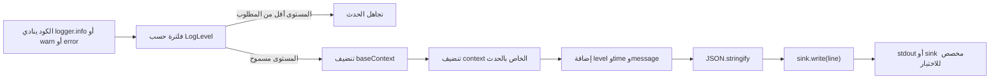
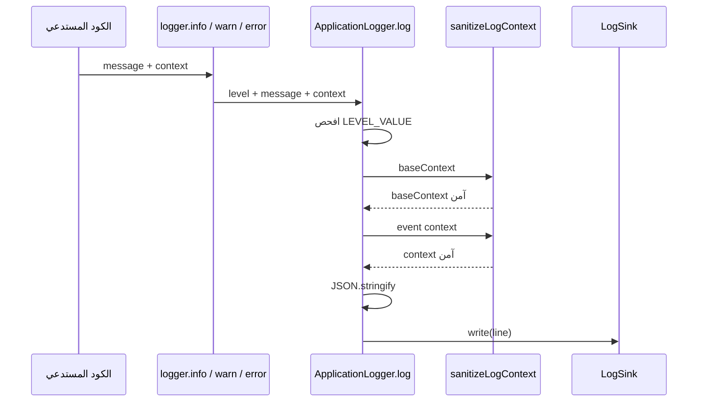
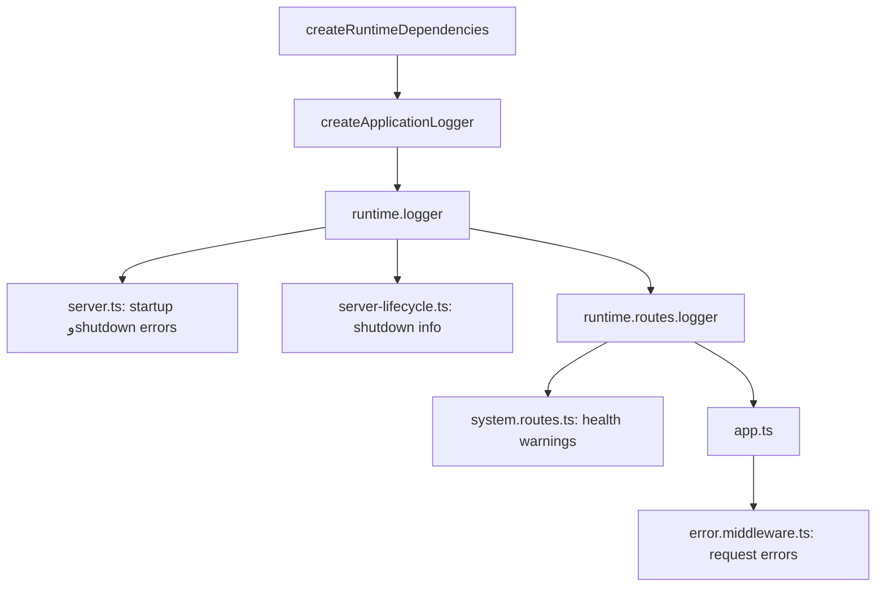
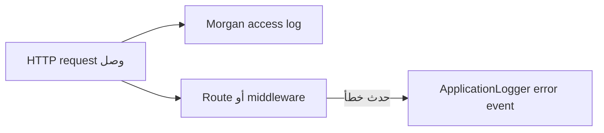

<div dir="rtl" align="right">

# شرح `src/shared/logger.ts` بالمصري

> **هدف الملف:** يعمل logger صغير وموحّد للتطبيق، يكتب logs على هيئة JSON، يفلتر الـlog levels، ويخفي بيانات حساسة زي الـpassword والـtoken والـemail قبل ما تتكتب.

> **تنبيه بخصوص الكود المنسوخ في المحادثة:** الـregex الحقيقي فيه `api[_-]?key` و`payment[_-]?payload`. ظهور `[*-]?` في المقتطف حصل بسبب تنسيق النسخ، ومش هو الكود الموجود في [`src/shared/logger.ts`](../../src/shared/logger.ts).

## 1. الملف ده بيعمل إيه في جملة واحدة؟

لما جزء من التطبيق يقول مثلًا:

```ts
logger.info("HTTP server listening", {
  host: "0.0.0.0",
  port: 8000,
});
```

الـlogger:

1. يشوف هل مستوى `info` مسموح ولا لأ.
2. ينضّف الـcontext من البيانات الحساسة.
3. يضيف وقت الحدث والـbase context.
4. يحوّل النتيجة لـJSON في سطر واحد.
5. يبعتها للـsink، والـsink الافتراضي بيكتبها في `stdout`.

الناتج هيبقى قريب من:

```json
{"level":"info","time":"2026-08-03T12:00:00.000Z","application":"cleanora-backend","environment":"development","host":"0.0.0.0","port":8000,"message":"HTTP server listening"}
```

## 2. مكان الملف وحدوده

- الملف: [`src/shared/logger.ts`](../../src/shared/logger.ts)
- موجود داخل `shared` لأن أكتر من جزء في التطبيق محتاج عقد الـlogging.
- بيصدر types وinterfaces وfactory functions.
- الـclass الفعلي `ApplicationLogger` مش exported، فباقي المشروع بيتعامل مع interface اسمها `Logger`.
- الملف ده مش مسؤول عن HTTP access logs؛ المهمة دي عند Morgan داخل [`src/middlewares/http-logger.ts`](../../src/middlewares/http-logger.ts).

## 3. الصورة العامة



## 4. `LogLevel`

الكود:

```ts
export type LogLevel = "debug" | "info" | "warn" | "error";
```

ده اسمه string union type، ومعناه إن قيمة مستوى الـlog لازم تكون واحدة بس من الأربع قيم دول:

- `debug`: تفاصيل تشخيصية دقيقة.
- `info`: حدث طبيعي مهم، زي إن السيرفر بدأ.
- `warn`: مشكلة حصلت لكن التطبيق لسه شغال، زي health check فشل.
- `error`: فشل حقيقي محتاج متابعة.

TypeScript هيرفض قيمة زي:

```ts
const level: LogLevel = "fatal";
```

لأن `fatal` مش موجودة في الـunion الحالية.

## 5. `LogContext`

الكود:

```ts
export type LogContext = Readonly<Record<string, unknown>>;
```

نفكها جزء جزء.

### `Record<string, unknown>`

معناها object:

- الـkeys بتاعته strings.
- كل value ممكن تكون أي نوع، لكن نوعها `unknown` لحد ما نفحصها.

أمثلة صالحة:

```ts
const context: LogContext = {
  port: 8000,
  ready: true,
  signal: "SIGTERM",
  details: { provider: "postgresql" },
};
```

### ليه `unknown` مش `any`؟

`unknown` أكثر أمانًا. مينفعش تستخدم القيمة كأنك عارف نوعها من غير فحص. وده مناسب للـlogging لأن الـcontext ممكن ييجي من أجزاء كتير بأنواع مختلفة.

### `Readonly`

بيمنع تعديل properties من خلال النوع ده في TypeScript.

لكن مهم تعرف حاجتين:

- ده منع وقت كتابة وفحص الكود، مش `Object.freeze` وقت التشغيل.
- الـ`Readonly` هنا shallow؛ يعني بيحمي properties الخارجية، مش شرط كل object متداخل.

## 6. عقد الـ`Logger`

```ts
export interface Logger {
  debug(message: string, context?: LogContext): void;
  info(message: string, context?: LogContext): void;
  warn(message: string, context?: LogContext): void;
  error(message: string, context?: LogContext): void;
  child(context: LogContext): Logger;
}
```

الـinterface بتقول إن أي logger معتمد في المشروع لازم يوفر الخمس methods دول.

### Methods المستويات الأربعة

كل method تستقبل:

1. `message`: نص الحدث، وده إجباري.
2. `context`: معلومات structured إضافية، ودي اختيارية.

وترجع `void`، يعني المستدعي مش مستني قيمة منها.

مثال من startup:

```ts
logger.info("HTTP server listening", {
  host: "0.0.0.0",
  port: 8000,
});
```

مثال من error middleware:

```ts
logger.error("Unexpected application error", {
  requestId: "request-123",
  code: "INTERNAL_SERVER_ERROR",
  statusCode: 500,
});
```

### `child(context)`

بترجع logger جديد واخد context ثابت زيادة، زي:

```ts
const authLogger = logger.child({ component: "auth" });

authLogger.info("Login completed", { userId: "user-1" });
```

أي log من `authLogger` هيشيل `component: "auth"` تلقائيًا.

## 7. عقد الـ`LogSink`

```ts
export interface LogSink {
  write(line: string): void;
}
```

الـsink هو المكان اللي الـlogger بيبعتله السطر النهائي.

الـlogger نفسه مش لازم يعرف السطر هيروح فين. كل المطلوب object فيه:

```ts
write(line: string): void
```

ده بيسمح بحالتين مهمين.

### التشغيل الطبيعي

الـsink الافتراضي بيكتب في `process.stdout`.

### الاختبارات

الاختبار يمرر sink يخزّن السطور في array:

```ts
const lines: string[] = [];

const sink: LogSink = {
  write: (line) => lines.push(line),
};
```

بكده الاختبار يراجع الـoutput من غير ما يطبع في terminal.

## 8. الثابت `REDACTED`

```ts
const REDACTED = "[REDACTED]";
```

دي القيمة البديلة لأي field اسمه حساس.

مثال input:

```ts
{
  userId: "user-1",
  password: "super-secret-password",
}
```

بعد التنضيف:

```ts
{
  userId: "user-1",
  password: "[REDACTED]",
}
```

استخدام كلمة ثابتة بدل حذف الـfield بالكامل مفيد؛ لأنه بيقول للمشغّل إن field كان موجود، لكن قيمته اتخبت عمدًا.

## 9. الـregex الخاص بالمفاتيح الحساسة

الكود الحقيقي:

```ts
const SENSITIVE_KEY =
  /(password|passcode|token|credential|verifier|jwt|api[_-]?key|email|phone|otp|secret|authorization|cookie|payment[_-]?payload)/iu;
```

الـregex بيفحص **اسم الـkey**، مش قيمة الـfield.

### الكلمات اللي بيعتبرها حساسة

| الجزء | أمثلة keys هيخبيها |
|---|---|
| `password` | `password`, `newPassword`, `passwordHash` |
| `passcode` | `passcode`, `recoveryPasscode` |
| `token` | `token`, `refreshToken`, `access_token` |
| `credential` | `credential`, `userCredentials` |
| `verifier` | `verifier`, `tokenVerifier` |
| `jwt` | `jwt`, `jwtPayload` |
| `api[_-]?key` | `apikey`, `api_key`, `api-key` |
| `email` | `email`, `normalizedEmail`, `emailEnabled` |
| `phone` | `phone`, `phoneNumber` |
| `otp` | `otp`, `otpCode` |
| `secret` | `secret`, `clientSecret` |
| `authorization` | `authorization`, `authorizationHeader` |
| `cookie` | `cookie`, `refreshCookie` |
| `payment[_-]?payload` | `paymentpayload`, `payment_payload`, `payment-payload` |

### معنى الـflags `i` و`u`

- `i`: case-insensitive، يعني `Password` و`PASSWORD` و`password` كلهم match.
- `u`: يعامل النص كـUnicode بصورة صحيحة.

### معنى `[_-]?`

- `[...]`: اختار character واحد من الموجودين.
- `_`: underscore.
- `-`: hyphen.
- `?`: الـcharacter اختياري، صفر أو مرة واحدة.

وعشان كده `apikey` و`api_key` و`api-key` كلهم بيتعرفوا.

### الـmatching مش لازم يكون اسم الـkey كله

مفيش `^` و`$` في الـregex، فالكلمة الحساسة ممكن تكون جزء من اسم أطول:

```text
refreshToken       → حساس
primaryEmail       → حساس
hashedPassword     → حساس
googleClientSecret → حساس
```

ده اختيار محافظ: ممكن يخبي field غير سري لمجرد إن اسمه فيه كلمة حساسة، زي `emailEnabled`. لكن الأفضل في الـlogs إننا نخبي زيادة بدل ما نسرّب بيانات شخصية.

### نقطة مهمة جدًا: الحماية مبنية على اسم الـkey

ده هيتخبى:

```ts
{ token: "private-value" }
```

لكن ده مش هيتعرف تلقائيًا إن قيمته secret:

```ts
{ data: "private-token-value" }
```

لأن اسم الـkey هو `data` ومفيهوش كلمة حساسة. معنى كده إن caller لازم يستخدم أسماء واضحة، ومينفعش يحط secrets تحت keys عامة.

## 10. خريطة مستويات الـlogging

```ts
const LEVEL_VALUE: Readonly<Record<LogLevel, number>> = {
  debug: 10,
  info: 20,
  warn: 30,
  error: 40,
};
```

ليه اتحولت المستويات لأرقام؟ عشان المقارنة تبقى سهلة.

### لو الـlogger معمول على `debug`

كل المستويات تتكتب:

| الحدث | القيمة | يتكتب؟ |
|---|---:|---:|
| debug | 10 | نعم |
| info | 20 | نعم |
| warn | 30 | نعم |
| error | 40 | نعم |

### لو الـlogger معمول على `info`

| الحدث | يتكتب؟ |
|---|---:|
| debug | لا |
| info | نعم |
| warn | نعم |
| error | نعم |

### لو على `warn`

| الحدث | يتكتب؟ |
|---|---:|
| debug | لا |
| info | لا |
| warn | نعم |
| error | نعم |

### لو على `error`

بيتكتب `error` بس.

## 11. الدالة الداخلية `sanitizeValue`

```ts
function sanitizeValue(
  value: unknown,
  visited: WeakSet<object>,
): unknown
```

دي قلب عملية التنضيف كلها.

### ليه الدالة مش `export`؟

لأنها implementation detail. باقي المشروع محتاج يقول:

```ts
sanitizeLogContext(context)
```

ومش محتاج يتحكم في الـ`WeakSet` أو ينادي recursion بنفسه.

### الـinputs

#### `value`

القيمة الحالية اللي الدالة بتنضفها. في أول استدعاء بتكون الـcontext كلها، وبعد كده تبقى nested object أو array item.

#### `visited`

`WeakSet` بيحفظ object references اللي اتشافِت قبل كده، عشان يمنع recursion لا نهائي لو فيه circular reference.

### الـoutput

نسخة آمنة قابلة للـlogging من القيمة، أو نفس primitive value لو مش object.

## 12. أول فرع: القيم البسيطة و`null`

```ts
if (typeof value !== "object" || value === null) {
  return value;
}
```

القيم دي بترجع زي ما هي:

- string.
- number.
- boolean.
- `undefined`.
- bigint من ناحية `sanitizeValue` نفسها.
- symbol.
- function.
- `null`.

ملحوظة: رجوع القيمة من `sanitizeValue` مش معناه إن `JSON.stringify` هيمثل كل الأنواع بنفس الطريقة. مثلًا:

- `undefined` وfunction وsymbol properties غالبًا بتتساب من object النهائي.
- `bigint` يسبب خطأ في `JSON.stringify`.

## 13. فرع الـ`Error`

```ts
if (value instanceof Error) {
  return { name: value.name, message: value.message };
}
```

لو القيمة Error، الـlogger مش بيحاول يكتب الـobject كله أو stack trace. بياخد بس:

```ts
{
  name: error.name,
  message: error.message,
}
```

مثال:

```ts
new Error("Database connection failed")
```

تتحول إلى:

```ts
{
  name: "Error",
  message: "Database connection failed",
}
```

### ملاحظة أمان

رسالة الـError نفسها مش بيطبق عليها فحص اسم key لأنها اتبنت مباشرة تحت `message`. عشان كده كود Cleanora بيحاول يمرر error metadata آمنة زي `errorName` و`causeCode` بدل رمي raw provider messages في الـcontext.

## 14. فرع الـ`Date`

```ts
if (value instanceof Date) {
  return value.toISOString();
}
```

الـDate بتتحول لنص ISO ثابت وسهل للقراءة والمعالجة:

```text
2026-08-03T12:34:56.789Z
```

حرف `Z` معناه UTC.

## 15. الحماية من circular references

```ts
if (visited.has(value)) {
  return "[Circular]";
}
visited.add(value);
```

مثال object بيلف على نفسه:

```ts
const context: Record<string, unknown> = {};
context["self"] = context;
```

من غير `visited`، recursion هتفضل شغالة لحد stack overflow.

بالـ`WeakSet` الناتج يبقى قريب من:

```ts
{
  self: "[Circular]",
}
```

### ليه `WeakSet`؟

- بيقبل objects فقط، وده المطلوب هنا.
- بيختبر object identity، مش تشابه المحتوى.
- مش محتاج يحتفظ بالـobjects للأبد بعد انتهاء عملية التنضيف.

### تفصيلة دقيقة

الكود بيعامل أي object reference اتشاف قبل كده على إنه `[Circular]`، حتى لو هو shared reference مش cycle حقيقي.

مثال:

```ts
const shared = { status: "ok" };
const context = { first: shared, second: shared };
```

غالبًا الناتج هيكون:

```ts
{
  first: { status: "ok" },
  second: "[Circular]",
}
```

وده مقبول لغرض log آمن ومختصر، لكنه فرق مهم عن deep cloning الكامل.

## 16. فرع الـarrays

```ts
if (Array.isArray(value)) {
  return value.map((item) => sanitizeValue(item, visited));
}
```

الدالة بتعمل array جديدة، وكل عنصر فيها بيتنضف recursively.

مثال:

```ts
{
  attempts: [
    { status: "failed", token: "private-1" },
    { status: "passed", token: "private-2" },
  ],
}
```

الناتج:

```ts
{
  attempts: [
    { status: "failed", token: "[REDACTED]" },
    { status: "passed", token: "[REDACTED]" },
  ],
}
```

## 17. فرع الـobjects العادية

```ts
const sanitized: Record<string, unknown> = {};
for (const [key, item] of Object.entries(value)) {
  sanitized[key] = SENSITIVE_KEY.test(key)
    ? REDACTED
    : sanitizeValue(item, visited);
}
return sanitized;
```

### `Object.entries(value)`

بترجع الـown enumerable string-keyed properties في صورة أزواج:

```ts
[
  ["userId", "user-1"],
  ["token", "private-token"],
]
```

### لكل key فيه قرارين

#### لو اسم الـkey حساس

القيمة كلها تتبدل فورًا بـ:

```ts
"[REDACTED]"
```

حتى لو القيمة nested object كبير، مش بيدخل جواه أصلًا.

#### لو اسم الـkey مش حساس

القيمة نفسها تروح تاني لـ`sanitizeValue`، عشان لو جواها object أو array تتنضف هي كمان.

### مثال كامل

قبل:

```ts
{
  requestId: "req-1",
  user: {
    id: "user-1",
    email: "private@example.test",
    credentials: {
      password: "private-password",
    },
  },
}
```

بعد:

```ts
{
  requestId: "req-1",
  user: {
    id: "user-1",
    email: "[REDACTED]",
    credentials: "[REDACTED]",
  },
}
```

لاحظ إن `credentials` نفسها key حساسة، فعشان كده الـobject كله اتخبى قبل الوصول إلى `password`.

## 18. `sanitizeLogContext`

```ts
export function sanitizeLogContext(context: LogContext): LogContext {
  return sanitizeValue(context, new WeakSet<object>()) as LogContext;
}
```

دي الواجهة العامة للتنضيف.

### مكان استدعائها

في النسخة الحالية مش بيستدعيها أي ملف خارجي مباشرة. استخدامها كله داخل `logger.ts`:

1. عند إنشاء logger لتنضيف `baseContext`.
2. داخل `child()` لتنضيف child context.
3. داخل `log()` لتنضيف base context.
4. داخل `log()` لتنضيف context الخاص بالحدث.

### الـinput

`LogContext` جه من caller، زي:

```ts
{
  requestId: "req-1",
  token: "private-token",
}
```

### ليه `new WeakSet<object>()` جديد كل مرة؟

كل عملية تنضيف لازم تكون مستقلة. لو استخدمنا نفس WeakSet للأبد، objects قديمة ممكن تتعامل غلط على إنها circular في logs جديدة.

### معنى `as LogContext`

`sanitizeValue` بترجع `unknown` لأنها عامة. هنا المبرمج عارف إن root input كان context object وإن الناتج المقصود context، فبيعمل type assertion.

الـassertion مش validation وقت التشغيل؛ هو توجيه لـTypeScript.

## 19. الـsink الافتراضي `defaultSink`

```ts
function defaultSink(line: string): void {
  process.stdout.write(`${line}\n`);
}
```

### مين بيناديها؟

مش الـlogger مباشرة باسمها. الـfactory تعمل default object:

```ts
{ write: defaultSink }
```

وبعدين `ApplicationLogger.log()` ينادي:

```ts
this.sink.write(line)
```

لو المستدعي ممررش sink مخصص، `write` هنا هي `defaultSink`.

### الـinput

`line` هو ناتج `JSON.stringify(...)`، يعني JSON string في سطر واحد.

### الـoutput والـside effect

- مفيش return value مفيدة؛ النتيجة `void`.
- بيكتب السطر في standard output.
- بيضيف newline `\n` عشان كل event يظهر في سطر لوحده.

الـdeployment platform يقدر يجمع stdout ويخزنها أو يعرضها.

## 20. الـclass: `ApplicationLogger`

```ts
class ApplicationLogger implements Logger
```

### `implements Logger`

TypeScript بيتأكد إن الـclass وفرت كل methods المطلوبة في interface `Logger`.

### ليه الـclass مش exported؟

باقي التطبيق مش محتاج يعرف implementation. هو محتاج العقد `Logger` بس، وبيحصل على instance من `createApplicationLogger`.

ده بيسهل:

- استبدال implementation لاحقًا.
- عمل test logger.
- منع باقي المشروع من الاعتماد على تفاصيل داخلية.

## 21. الـconstructor والـparameter properties

```ts
constructor(
  private readonly level: LogLevel,
  private readonly baseContext: LogContext,
  private readonly sink: LogSink,
) {}
```

TypeScript هنا بيعمل ثلاث properties داخل الـinstance تلقائيًا.

### `level`

أقل مستوى مسموح بكتابته.

### `baseContext`

معلومات ثابتة تتكرر مع كل log من الـinstance، زي:

```ts
{
  application: "cleanora-backend",
  environment: "production",
}
```

### `sink`

المكان اللي يستقبل السطر النهائي.

### `private`

مينفعش كود خارجي يوصل مباشرة إلى:

```ts
logger.level
logger.baseContext
logger.sink
```

### `readonly`

الـclass نفسها مش المفروض تغيّر references دي بعد الـconstructor.

## 22. Methods: `debug`, `info`, `warn`, `error`

```ts
debug(message: string, context: LogContext = {}): void {
  this.log("debug", message, context);
}
```

والباقي نفس الفكرة:

```ts
info  → this.log("info", ...)
warn  → this.log("warn", ...)
error → this.log("error", ...)
```

كل method public بسيطة مسؤولة عن تثبيت level المناسب، وبعدين تسلّم الشغل الحقيقي للـprivate method `log`.

### الـdefault context

لو caller كتب:

```ts
logger.info("Graceful shutdown completed");
```

الـcontext تبقى `{}` تلقائيًا.

## 23. `child(context)` بالتفصيل

```ts
child(context: LogContext): Logger {
  return new ApplicationLogger(
    this.level,
    { ...this.baseContext, ...sanitizeLogContext(context) },
    this.sink,
  );
}
```

### الـinput

context جديد عايزين نضيفه لكل logs الخاصة بالـchild.

### إيه اللي بيتورث؟

- نفس `level`.
- نفس `sink` object.
- كل `baseContext` القديم.

### إيه اللي بيتضاف؟

الـchild context بعد تنضيفه.

### ترتيب الدمج

```ts
{
  ...this.baseContext,
  ...sanitizeLogContext(context),
}
```

لو نفس الـkey موجود في الاتنين، قيمة child context هي اللي تكسب لأنها اتفردت في الآخر.

مثال:

```ts
const root = createApplicationLogger("info", {
  application: "cleanora-backend",
  component: "root",
});

const child = root.child({ component: "auth" });
```

الـchild base context هيبقى:

```ts
{
  application: "cleanora-backend",
  component: "auth",
}
```

### هل `child()` بيكتب log؟

لأ. هو بيكوّن logger جديد بس. الكتابة تحصل لما تنادي `info` أو غيرها على الناتج.

### أماكن الاستدعاء الحالية

في runtime code الحالي مفيش استدعاء لـ`child()`. الاستدعاء الموجود في [`tests/integration/logging.test.ts`](../../tests/integration/logging.test.ts) بيمرّن مسار إنشاء child ويثبت إن الـchild يقدر يكتب event. الاختبار الحالي لا يعمل assertion مستقلة على ظهور `component: "auth"` في الناتج.

## 24. الـprivate method: `log`

```ts
private log(level: LogLevel, message: string, context: LogContext): void
```

دي المسؤولة عن:

1. فلترة المستوى.
2. بناء log object.
3. تنضيف contexts.
4. تحويل الناتج لـJSON.
5. الكتابة في sink.

## 25. فلترة مستوى الـlog

```ts
if (LEVEL_VALUE[level] < LEVEL_VALUE[this.level]) {
  return;
}
```

### مثال: logger مستواه `info`

لو نادينا:

```ts
logger.debug("details");
```

المقارنة:

```text
LEVEL_VALUE.debug = 10
LEVEL_VALUE.info  = 20
10 < 20           = true
```

إذًا الدالة تعمل `return` قبل:

- إنشاء التاريخ.
- تنضيف الـcontext.
- `JSON.stringify`.
- الكتابة في sink.

وده مهم للأداء: logs المرفوضة بتخرج بدري.

### مثال: `warn` مع logger مستواه `info`

```text
30 < 20 = false
```

فـ`warn` تتكتب.

## 26. بناء الـlog object وترتيب الدمج

```ts
JSON.stringify({
  level,
  time: new Date().toISOString(),
  ...sanitizeLogContext(this.baseContext),
  ...sanitizeLogContext(context),
  message,
})
```

الترتيب مهم جدًا في JavaScript object spread.

### الترتيب

1. `level`.
2. `time`.
3. الـbase context.
4. event context.
5. `message`.

لو key اتكرر، آخر قيمة هي اللي تكسب.

### الـevent context يغلب الـbase context

```ts
baseContext  = { component: "application" }
context      = { component: "database" }
```

الناتج:

```ts
{ component: "database" }
```

### `message` محمية بترتيبها

حتى لو الـcontext فيها:

```ts
{ message: "fake message" }
```

الـ`message` parameter الأصلية هي اللي تكسب لأنها مكتوبة في الآخر.

### تفصيلة لازم تبقى واخد بالك منها

بما إن `baseContext` و`context` بعد `level` و`time`، caller يقدر يمرر keys باسم `level` أو `time` فتغطي قيم الـoutput الظاهرة.

لكن قرار الفلترة نفسه حصل قبل الدمج باستخدام parameter `level` الحقيقي. يعني ممكن الحدث يتفلتر كـ`error` لكن context غير منضبط يغيّر field `level` المكتوب. عشان كده callers المفروض ما يستخدموش reserved keys دي داخل context.

## 27. الوقت

```ts
time: new Date().toISOString()
```

كل log مسموح بيها تاخد وقت جديد لحظة الكتابة.

- النوع النهائي string.
- التنسيق ISO 8601.
- التوقيت UTC.
- سهل على أنظمة تجميع وتحليل الـlogs.

## 28. `JSON.stringify`

بعد تكوين object الآمن، بيتحوّل لسطر JSON:

```ts
JSON.stringify(logObject)
```

ليه JSON بدل نص حر؟

- سهل parsing آليًا.
- كل field ليه اسم ثابت.
- نقدر نبحث بـ`requestId` أو `code` أو `statusCode`.
- deployment log tools تقدر تفهرسه.

مثال:

```json
{"level":"error","time":"2026-08-03T12:00:00.000Z","application":"cleanora-backend","requestId":"req-1","code":"INTERNAL_SERVER_ERROR","statusCode":500,"message":"Unexpected application error"}
```

## 29. الكتابة إلى الـsink

الكود الكامل:

```ts
this.sink.write(
  JSON.stringify({
    // fields
  }),
);
```

يعني الـcall chain هو:



## 30. الـfactory: `createApplicationLogger`

```ts
export function createApplicationLogger(
  level: LogLevel,
  baseContext: LogContext = {},
  sink: LogSink = { write: defaultSink },
): Logger {
  return new ApplicationLogger(level, sanitizeLogContext(baseContext), sink);
}
```

دي الطريقة الرسمية لإنشاء logger حقيقي.

### parameter الأول: `level`

إجباري، وبيحدد أقل مستوى مسموح.

### parameter الثاني: `baseContext`

اختياري، والـdefault `{}`.

بيتنضف مرة وقت الإنشاء قبل التخزين.

### parameter الثالث: `sink`

اختياري، والـdefault:

```ts
{ write: defaultSink }
```

### القيمة المرجعة

النوع المعلن `Logger`، مش `ApplicationLogger`.

ده بيخفي implementation ويدي باقي التطبيق العقد اللي محتاجها بس.

## 31. أماكن استدعاء `createApplicationLogger`

### 1. الـruntime logger الرئيسي

الملف: [`src/composition.ts`](../../src/composition.ts)

```ts
const logger = createApplicationLogger(environment.LOG_LEVEL, {
  application: APPLICATION_NAME,
  environment: environment.NODE_ENV,
});
```

#### مصدر الـinputs

```text
process.env.LOG_LEVEL
→ loadEnvironment
→ environment.LOG_LEVEL
→ level
```

```text
APPLICATION_NAME
→ src/config/constants.ts
→ "cleanora-backend"
```

```text
process.env.NODE_ENV
→ loadEnvironment
→ environment.NODE_ENV
```

الـsink مش متبعت، فبيستخدم stdout.

الناتج يتحط في:

```ts
runtime.logger
```

وبعدين نفس الـinstance يتبعت للـroutes والـerror middleware والـserver lifecycle.

### 2. logger احتياطي لفشل startup

الملف: [`src/server.ts`](../../src/server.ts)

```ts
const logger = createApplicationLogger("error", {
  application: APPLICATION_NAME,
});
```

ده بيتعمل لو `startApplication()` فشلت.

#### ليه مش بيستخدم `runtime.logger`؟

لأن الخطأ ممكن يحصل في `loadEnvironment` قبل إنشاء runtime أصلًا.

#### الـinputs

- level ثابت: `"error"`.
- application ثابت: `"cleanora-backend"`.
- base context مفيهاش `environment` لأن environment نفسها ممكن تكون invalid.
- sink الافتراضي: stdout.

### 3. اختبار الـapplication logger

الملف: [`tests/integration/logging.test.ts`](../../tests/integration/logging.test.ts)

```ts
const logger = createApplicationLogger(
  "debug",
  { application: "cleanora-test" },
  { write: (line) => lines.push(line) },
);
```

هنا الاختبار يمرر custom sink يخزن السطور.

### 4. logger مستخدم مع اختبار Morgan

نفس ملف الاختبار ينشئ:

```ts
const logger = createApplicationLogger("info");
```

لكن فحص HTTP access output نفسه بيستخدم stream خاص بـMorgan، مش output الـapplication logger.

## 32. أماكن استخدام `logger.info`

### نجاح بدء HTTP server

[`src/server.ts`](../../src/server.ts):

```ts
runtime.logger.info("HTTP server listening", {
  host: HTTP_BIND_HOST,
  port: environment.PORT,
});
```

مصدر الـcontext:

- `host`: ثابت `HTTP_BIND_HOST = "0.0.0.0"`.
- `port`: environment بعد validation.

### بدء graceful shutdown

[`src/server-lifecycle.ts`](../../src/server-lifecycle.ts):

```ts
logger.info("Graceful shutdown started", { signal });
```

`signal` جاية من:

```ts
shutdown("SIGINT")
```

أو:

```ts
shutdown("SIGTERM")
```

### اكتمال graceful shutdown

```ts
logger.info("Graceful shutdown completed");
```

مفيش event context، فيستخدم `{}`، لكن الـbase context لسه موجودة.

## 33. أماكن استخدام `logger.warn`

الاستخدامات runtime موجودة في [`src/routes/system.routes.ts`](../../src/routes/system.routes.ts).

### فشل readiness check

```ts
dependencies.logger.warn("Readiness check failed", {
  requestId: request.requestId,
  failedProbes: failed,
});
```

مصدر الـinputs:

- `requestId`: request ID middleware حطته على Express request.
- `failedProbes`: ناتج `Promise.allSettled` على readiness probes.

### فشل database health check

```ts
dependencies.logger.warn("Database health check failed", {
  requestId: request.requestId,
});
```

بيتكتب لما database probe تكون مش موجودة أو `check()` ترمي خطأ.

الخطأ الخام نفسه مش بيتكتب، وده يمنع تسريب تفاصيل database.

## 34. أماكن استخدام `logger.error`

### فشل graceful shutdown

[`src/server.ts`](../../src/server.ts):

```ts
runtime.logger.error("Graceful shutdown failed", {
  errorName: error instanceof Error ? error.name : "UnknownError",
});
```

القيمة المسجلة هي اسم الخطأ فقط، مش الرسالة الخام.

### فشل startup النهائي

```ts
logger.error(
  "Application startup failed",
  createStartupFailureContext(error),
);
```

الـcontext جاية من دالة بتبني diagnostics آمنة من الخطأ.

### أخطاء Express

[`src/middlewares/error.middleware.ts`](../../src/middlewares/error.middleware.ts):

```ts
logger.error(appError.message, {
  requestId: request.requestId,
  code: appError.code,
  statusCode: appError.statusCode,
  errorName: appError.name,
  ...describeSafeCause(appError.cause),
});
```

مصدر كل input:

| field | المصدر |
|---|---|
| `message` | `AppError.message` بعد تحويل الخطأ لنوع application error. |
| `requestId` | request ID middleware. |
| `code` | application error code. |
| `statusCode` | application error HTTP status. |
| `errorName` | اسم `AppError`. |
| cause metadata | `describeSafeCause` ترجع name/code وعبارة ثابتة آمنة فقط. |

## 35. استخدام `debug` و`child` حاليًا

- `logger.debug(...)` مش مستخدمة في runtime code الحالي؛ موجودة في اختبار الـlogging.
- `logger.child(...)` مش مستخدمة في runtime code الحالي؛ موجودة في اختبار الـlogging.
- وجودهم في العقد بيسمح باستخدامهم مستقبلًا من غير تغيير interface.

## 36. إزاي نفس الـlogger بيوصل لكل الأماكن دي؟



المهم هنا إن ده نفس logger instance، بنفس level ونفس base context ونفس sink.

## 37. الفرق بين `ApplicationLogger` وMorgan

التعليق في آخر الملف بيقول:

```ts
Morgan remains the only HTTP access logger.
```

### `ApplicationLogger`

يسجل application events:

- startup.
- shutdown.
- readiness failures.
- database health failures.
- application errors.
- provider failures عند استخدامها.

### Morgan

يسجل كل HTTP access بالشكل الآمن:

- method.
- path بدون query string.
- status.
- response time.
- request ID.
- معلومات محدودة حسب environment.

ومش بيسجل:

- request body.
- query string.
- authorization header.
- cookies.



ممكن request واحدة تنتج access log من Morgan وapplication error log من `ApplicationLogger`، وكل واحد ليه غرض مختلف.

## 38. `TestLogger` وعلاقة الـinterface بالاختبارات

الملف [`tests/helpers/test-logger.ts`](../../tests/helpers/test-logger.ts) فيه:

```ts
export class TestLogger implements Logger
```

ده implementation مختلف لنفس العقد.

- `debug`, `info`, `warn` ما بيعملوش حاجة.
- `error` يخزن آخر error آمنة بدل طباعتها.
- `child` يرجع نفس test logger.

ده يوضح فايدة interface `Logger`: ملفات التطبيق تستقبل العقد، ومش فارق معاها هل implementation هو الحقيقي أو test double.

## 39. الاختبار الأساسي للملف

[`tests/integration/logging.test.ts`](../../tests/integration/logging.test.ts) بيعمل logger بالمستوى `debug` وcustom sink.

وبعدين ينادي:

```ts
logger.debug("debug event");

logger.info("login event", {
  password: "do-not-log",
  token: "do-not-log",
  email: "private@example.test",
  nested: {
    otp: "nested-otp-must-not-log",
    refreshToken: "nested-refresh-token-must-not-log",
  },
});

logger.child({ component: "auth" }).info("child event");
```

الاختبار يتأكد إن:

- رسالة `login event` موجودة.
- `[REDACTED]` موجودة.
- `child event` موجودة.
- password الأصلية مش موجودة.
- token الأصلية مش موجودة.
- email الأصلية مش موجودة.
- nested OTP مش موجودة.
- nested refresh token مش موجودة.

وده يثبت التنضيف recursive، مش على أول مستوى بس.

## 40. مثال كامل خطوة بخطوة

نفترض إننا أنشأنا logger كده:

```ts
const logger = createApplicationLogger(
  "info",
  {
    application: "cleanora-backend",
    environment: "production",
  },
  customSink,
);
```

وبعدين نادينا:

```ts
logger.error("Login provider failed", {
  requestId: "req-123",
  provider: "google",
  email: "private@example.test",
  nested: {
    accessToken: "private-token",
  },
});
```

### الخطوة 1: method تثبت المستوى

```ts
this.log("error", message, context);
```

### الخطوة 2: الفلترة

```text
LEVEL_VALUE.error = 40
LEVEL_VALUE.info  = 20
40 < 20 = false
```

فالـevent مسموحة.

### الخطوة 3: تنضيف base context

مفيهاش keys حساسة، فتفضل زي ما هي.

### الخطوة 4: تنضيف event context

```ts
{
  requestId: "req-123",
  provider: "google",
  email: "[REDACTED]",
  nested: {
    accessToken: "[REDACTED]",
  },
}
```

### الخطوة 5: الدمج

```ts
{
  level: "error",
  time: "2026-08-03T12:00:00.000Z",
  application: "cleanora-backend",
  environment: "production",
  requestId: "req-123",
  provider: "google",
  email: "[REDACTED]",
  nested: {
    accessToken: "[REDACTED]",
  },
  message: "Login provider failed",
}
```

### الخطوة 6: JSON والـsink

الـobject يتحول لسطر JSON ويتبعت إلى:

```ts
customSink.write(line)
```

## 41. حدود مهمة لازم تبقى فاهمها

دي مش بالضرورة أخطاء؛ دي حدود السلوك الحالي للملف.

### 1. التنضيف معتمد على أسماء الـkeys

قيمة سرية تحت key عام زي `data` مش هتتكتشف تلقائيًا.

### 2. `Error.message` بتتسجل

لو مررت Error object داخل key غير حساس، `sanitizeValue` تحتفظ بـ`name` و`message`. مينفعش provider error message تحتوي secrets.

### 3. الـ`message` الرئيسية مش بتدخل الـsanitizer

الـ`message` parameter بتتحط في الناتج مباشرة. عشان كده رسائل الـlog المفروض تكون عبارات ثابتة وآمنة، والبيانات المتغيرة تتحط كـsafe structured context.

### 4. الـregex محافظ وواسع

ممكن يخبي قيمة غير سرية زي `emailEnabled` بسبب وجود كلمة `email` في الاسم.

### 5. shared reference تظهر `[Circular]`

حتى لو مفيش cycle حقيقي، تكرار نفس object identity للمرة الثانية يتعامل معاه كـ`[Circular]`.

### 6. `BigInt` غير مدعوم بواسطة `JSON.stringify`

لو context فيها bigint تحت key غير حساس، التحويل لـJSON هيرمي TypeError.

### 7. بعض أسماء الـcontext لازم نتجنبها

`level` و`time` ممكن يغطوا القيم المبنية قبلهم بسبب ترتيب object spread. `message` مش ممكن تتغطى لأنها مكتوبة في الآخر.

### 8. الكتابة synchronous من منظور الـinterface

`LogSink.write` بترجع `void`، والـlogger مش بينتظر Promise ولا يتعامل مع backpressure كجزء من العقد الحالي.

## 42. علاقته بالـauthentication والـauthorization

الملف مهم أمنيًا لأن authentication وauthorization بيتعاملوا مع بيانات حساسة جدًا:

- access tokens.
- refresh tokens.
- cookies.
- email وphone.
- OTP.
- credentials.
- privileged reasons أو payment payloads.

الـlogger بيقلل خطر تسريبهم، لكن ده مش تصريح إن أي object يتبعتله بأمان. القاعدة تفضل:

> سجّل أقل معلومات لازمة، استخدم safe metadata، ومتبعثش raw request أو raw token أو raw provider error للـlogger.

في authorization القادم، معلومات مفيدة وآمنة للـlog ممكن تكون:

```ts
{
  requestId,
  actorId,
  permissionCode,
  decision: "denied",
  reasonCode,
}
```

لكن مينفعش نسجل credentials أو session tokens أو محتوى حساس لمجرد إن sanitizer موجود.

## 43. الخلاصة

احفظ السلسلة دي:

```text
createApplicationLogger
→ ApplicationLogger
→ debug/info/warn/error
→ private log
→ فحص LEVEL_VALUE
→ sanitize baseContext
→ sanitize event context
→ إضافة level/time/message
→ JSON.stringify
→ sink.write
→ stdout أو test sink
```

وأهم ثلاث أفكار:

1. `Logger` عقد، و`ApplicationLogger` implementation مخفي.
2. الفلترة بتحصل قبل التنضيف والكتابة.
3. الـredaction recursive لكنه معتمد على **اسم الـkey**.

## 44. الملف التالي المقترح

بعد ما فهمنا نقطة التشغيل والـlogger، أنسب ملف نرجعله هو:

[`src/composition.ts`](../../src/composition.ts)

لأنه المكان اللي أنشأ الـlogger الرئيسي ومرّر نفس الـinstance للـroutes، وبعدها `server.ts` مرّره للـserver lifecycle والـerror handling. وهو كمان بوابة فهم كل authentication dependencies.

</div>
