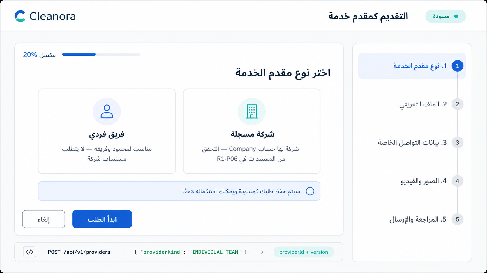
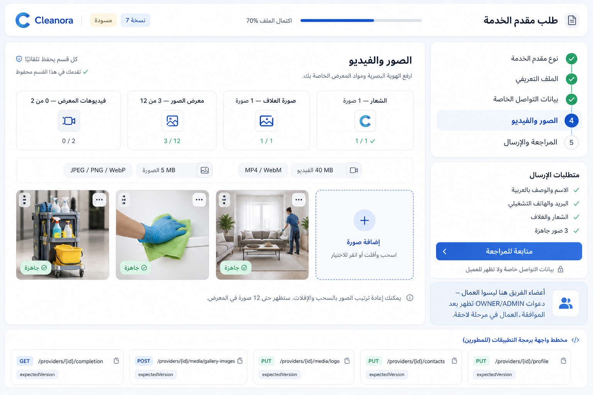
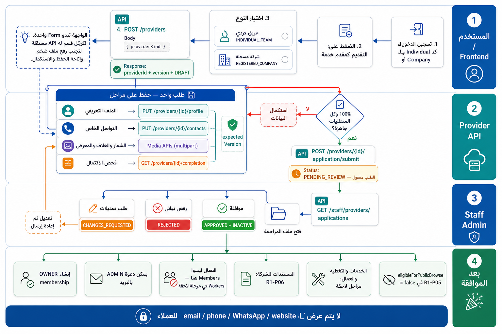

# R1-P05 Provider Application — UX and Frontend Integration Handoff

## The core model

The customer experiences **one Provider application**, but the backend stores
and validates it as a draft aggregate with separately saved resources. The
first endpoint starts the draft; it does not submit the finished dossier.

```text
POST /api/v1/providers                         start/resume draft
PUT  /api/v1/providers/{id}/profile            save profile section
PUT  /api/v1/providers/{id}/contacts           save private contacts
... /api/v1/providers/{id}/media/*             upload/manage media
GET  /api/v1/providers/{id}/completion         server-calculated progress
POST /api/v1/providers/{id}/application/submit final handoff to Staff review
```

This split is deliberate: media is multipart and may process independently;
sections can autosave/resume; contacts have stricter privacy; and every mutation
uses one optimistic-concurrency `expectedVersion`.

## Applicant pages

1. `/provider/apply`
   - Load `GET /providers`.
   - Resume the row whose relationship is `APPLICATION_OWNER`, or show the
     kind chooser if no owned application exists.
   - Start with `POST /providers { providerKind }`.
2. `/provider/apply/{providerId}/profile`
   - `GET/PUT /providers/{providerId}/profile`.
3. `/provider/apply/{providerId}/contacts`
   - `GET/PUT /providers/{providerId}/contacts`.
   - Values are private and never copied into preview.
4. `/provider/apply/{providerId}/media`
   - `GET /providers/{providerId}/media`.
   - Logo/cover/gallery uploads use multipart `file` plus
     `expectedVersion`.
5. `/provider/apply/{providerId}/review`
   - Read aggregate, completion, readiness, preview, and history.
   - Submit with `POST /providers/{providerId}/application/submit`.
6. `/provider/apply/{providerId}/status`
   - `PENDING_REVIEW`: read-only waiting page.
   - `CHANGES_REQUESTED`: show Staff reason and reopen the relevant steps.
   - `REJECTED`: terminal read-only result.
   - `APPROVED`: route to Provider dashboard; operational status is still
     `INACTIVE`.

## Frontend state

Keep at least:

```ts
type ProviderApplicationState = {
  providerId: string;
  version: number;
  providerKind: "INDIVIDUAL_TEAM" | "REGISTERED_COMPANY";
  applicationStatus:
    | "DRAFT"
    | "PENDING_REVIEW"
    | "CHANGES_REQUESTED"
    | "APPROVED"
    | "REJECTED";
  operationalStatus: "INACTIVE" | "LIVE" | "SUSPENDED";
  completionPercentage: number;
  missingRequirementCodes: string[];
  canEdit: boolean;
};
```

After **every mutation**, replace the local `version` with the version returned
by the server. Serialize application mutations; do not launch profile, contacts,
and multiple uploads concurrently with the same version.

On `409 PROVIDER_VERSION_CONFLICT`, refetch the affected section plus aggregate,
update the local version, and ask the user to retry/confirm if local edits would
be overwritten.

## Exact request examples

Start draft:

```json
{ "providerKind": "INDIVIDUAL_TEAM" }
```

Save profile:

```json
{
  "displayNameAr": "فريق محمود للنظافة",
  "displayNameEn": null,
  "descriptionAr": "فريق متخصص في تنظيف الشقق",
  "descriptionEn": null,
  "countryCode": "EG",
  "expectedVersion": 2
}
```

Save private contacts:

```json
{
  "operationalEmail": "ops@example.com",
  "operationalPhone": "+201000000000",
  "channels": [],
  "expectedVersion": 3
}
```

Upload media:

```ts
const body = new FormData();
body.append("file", file);
body.append("expectedVersion", String(currentVersion));

await fetch(`/api/v1/providers/${providerId}/media/gallery-images`, {
  method: "POST",
  headers: { Authorization: `Bearer ${accessToken}` },
  body,
});
```

Do not manually set the `Content-Type` header for `FormData`; the browser must
add the multipart boundary.

Submit:

```json
{ "expectedVersion": 8 }
```

## Submission requirements

The API owns the percentage. The frontend must display, not recalculate, these
ten equal checks: eligible verified category, matching complete customer
profile, Arabic name, Arabic description, operational email, operational
phone, active country, READY logo, READY cover, and at least three READY gallery
images.

Videos are optional for submission, with a maximum of two. The gallery allows
up to twelve images. The server remains authoritative for size, format,
dimensions, processing state, and counts.

## Members are not workers

R1-P05 `members` are Provider management accounts only:

- `OWNER`: created atomically when Staff approves the application.
- `ADMIN`: invited by the OWNER after approval.

Mahmoud's cleaners are **workers**, not Provider members in this phase. Worker
roster, services, coverage, and operational capacity belong to later phases and
must not appear in the R1-P05 application form.

## Staff flow

1. `GET /staff/providers/applications` lists submitted applications.
2. `GET /staff/providers/applications/{providerId}` opens the dossier.
3. Staff chooses one command:
   - approve: `{ expectedVersion }` → `APPROVED + INACTIVE`;
   - request changes: `{ reason, expectedVersion }` →
     `CHANGES_REQUESTED`;
   - reject: `{ reason, expectedVersion }` → terminal `REJECTED`.
4. A changes request reopens the applicant wizard and the next submission
   creates a new review cycle without deleting prior history.

## After approval

The OWNER may invite management ADMINs with:

```http
POST /api/v1/providers/{providerId}/admin-invitations
```

```json
{ "email": "admin@example.com", "expectedVersion": 12 }
```

An existing user signs in with the invited email and accepts. A new user follows
the invitation-only phone/password/email-OTP flow, receives a restricted
principal, then accepts. Neither path creates a customer category or ownership.

Company documents remain an R1-P06 readiness gate. Payout, workers, services,
coverage, and becoming `LIVE` are later-phase gates. Therefore
`eligibleForPublicBrowse` remains `false` throughout R1-P05.

## Privacy

Operational email, phone, WhatsApp, social links, website, and external booking
references are private. Customer-facing UI must use only
`GET /providers/{providerId}/preview`, whose DTO is allowlisted and contact-free.

## Design images

### Start application



### Media and completion step



### Full end-to-end flow


